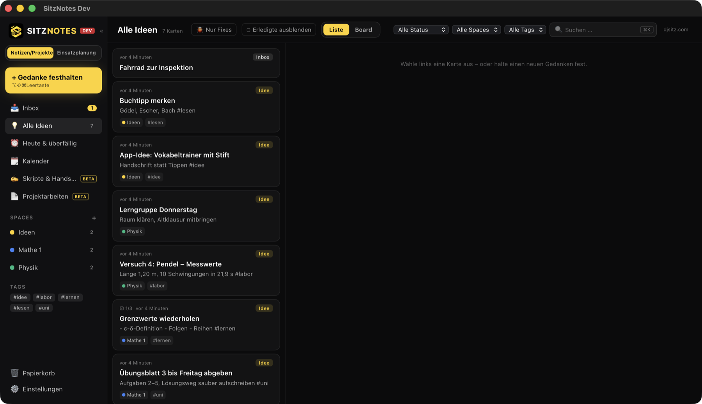
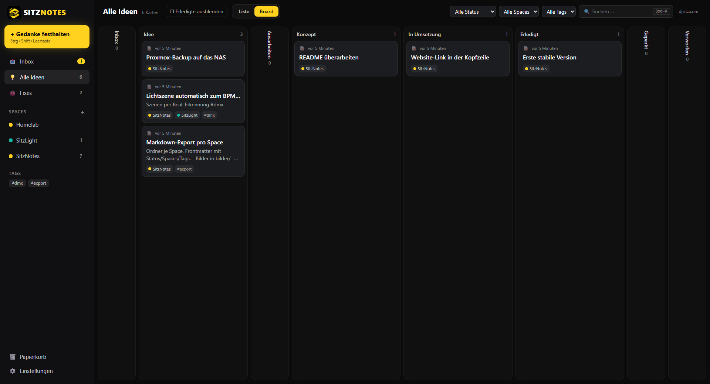
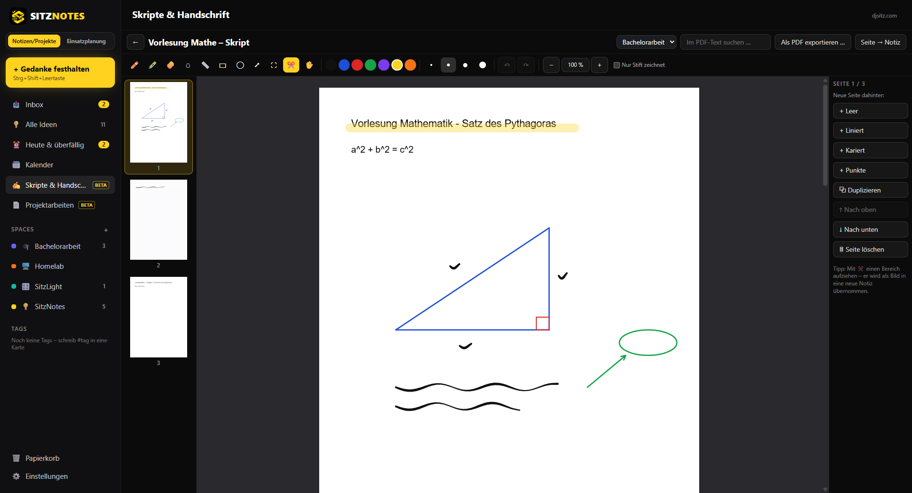
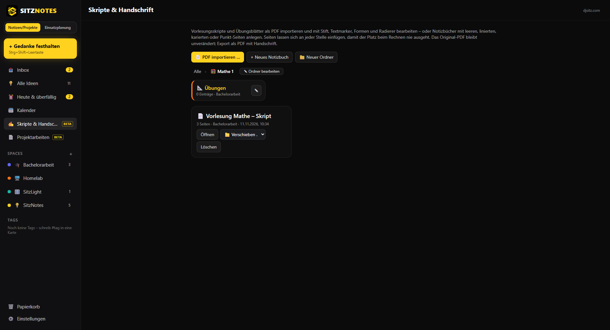
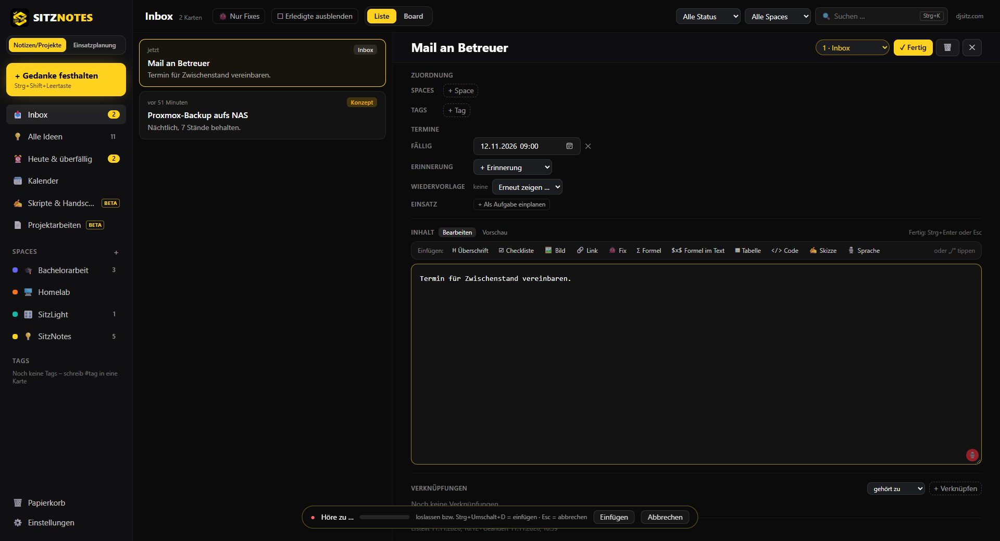
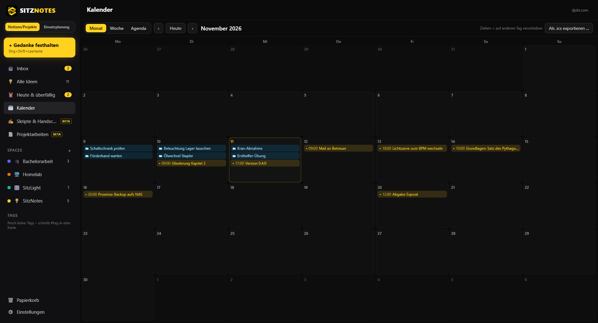
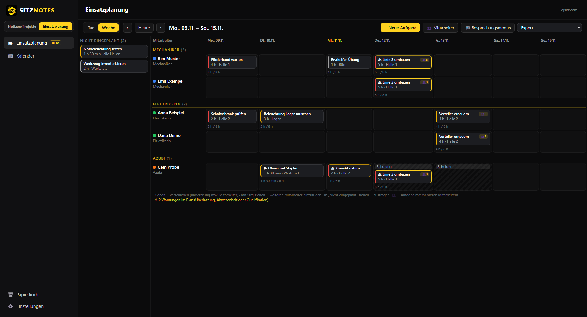
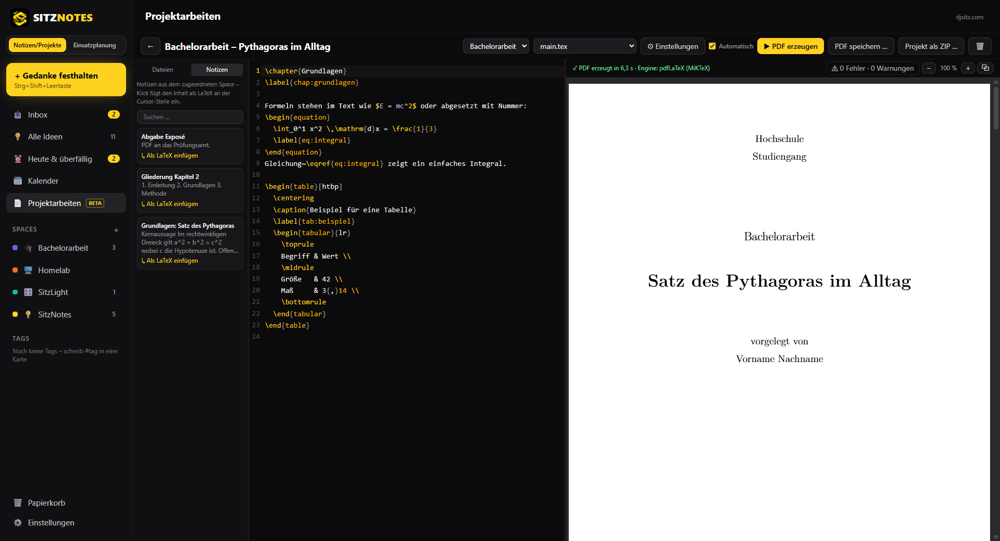

  

<h1 align="center">SitzNotes</h1>

  Gedanken in Sekunden festhalten, zuordnen, verknüpfen und wiederfinden – 
  für Windows und macOS (iPhone/iPad folgen).

  Deine Daten bleiben lokal auf deinem Gerät. Kein Konto, kein Server – 
  PC und Mac gleichen sich auf Wunsch über deinen eigenen Cloud- oder NAS-Ordner ab.

  <a href="https://github.com/Sitz9/sitznotes-releases/releases/latest"><b>⬇ Neueste Version herunterladen</b></a>
  &nbsp;·&nbsp;
  <a href="https://github.com/Sitz9/sitznotes-releases/releases">Alle Versionen &amp; Patchnotes</a>
  &nbsp;·&nbsp;
  <a href="https://djsitz.com">djsitz.com</a>

  

---

## Was SitzNotes kann

- **Quick Capture von überall:** Ein Tastenkürzel öffnet ein kleines Eingabefenster über allen Programmen – tippen, Enter, fertig. Der Gedanke landet in der **Inbox**.
- **Ein Gedanke kann alles enthalten:** Text, Überschriften, **Checklisten** (direkt abhakbar), Links, Tabellen, **Bilder** und **Formeln** gemischt in einem Inhalt (Markdown).
- **Einfügen-Leiste** über dem Text – Überschrift, Checkliste, Bild, Link, Fix, Formel, Tabelle, Code – oder einfach **„/" tippen** (z. B. `/checkliste`, `/formel`).
- **Formeln in LaTeX-Schreibweise:** `$E = mc^2$` im Text oder als eigener Block mit `$$ … $$`.
- **Zuordnen:** Spaces (Projekte/Themen mit Farbe und Icon), Tags (`#tag` im Text wird automatisch erkannt), Status von „Inbox" bis „Erledigt". SitzNotes schlägt passende Spaces vor („gehört wahrscheinlich zu …"). Eine Karte kann in mehreren Spaces liegen.
- **Verknüpfungen** zwischen Karten: gehört zu, inspiriert von, blockiert, Alternative zu, Teil von.
- **Synchronisation über deinen eigenen Ordner** (OneDrive, iCloud Drive, Dropbox, Google Drive oder NAS): PC und Mac bleiben automatisch auf demselben Stand – ohne Konto und ohne SitzNotes-Server, optional **Ende-zu-Ende-verschlüsselt**. Gleichzeitig auf zwei Geräten geändert? Dann gibt es eine **Konfliktkopie** statt Datenverlust.
- **Kalender & Erinnerungen:** Fälligkeit, Erinnerungen und Wiedervorlage an jeder Karte, Kalender (Monat/Woche/Agenda) mit Drag & Drop, **„Heute & überfällig"** in der Seitenleiste, Erinnerungen mit „Öffnen", „Erledigt" und „Später" – auch wenn das Fenster geschlossen ist. Export als **.ics** für Outlook, Apple oder Google Kalender.
- **Quick Capture versteht Zeitangaben** wie „morgen 9 Uhr", „Freitag" oder „in 2 Wochen" und setzt die Fälligkeit.
- **Skripte & Handschrift (Beta):** Vorlesungsskripte und Übungsblätter als **PDF importieren** oder **Notizbücher** mit leeren, linierten, karierten oder Punkt-Seiten anlegen – und mit **druckempfindlichem Stift**, **Textmarker**, **Radierer** (ganzer Strich oder nur ein Bereich), **Lineal/geraden Linien**, **Formen** und **Lasso** bearbeiten. **Seiten an jeder Stelle einfügen**, duplizieren, löschen und umsortieren – der Platz beim Rechnen geht nie aus. Zoom, Seitenübersicht, **Suche im PDF-Text**, **Export als PDF mit Handschrift** (das Original bleibt unverändert), Seite oder Ausschnitt als Bild in eine Notiz. Funktioniert mit Maus, Touch und Grafiktablett.
  - **Ordner/Kurse:** z. B. „Mathe 1" mit Unterordnern, Farbe und Symbol, optional einem Space zugeordnet – Skripte und Notizbücher per Drag & Drop einsortieren.
  - **Kopieren, Ausschneiden, Einfügen, Duplizieren:** mit dem Lasso auswählen, dann über die Leiste an der Auswahl, per Rechtsklick (bzw. langes Drücken) oder mit **Strg+C / Strg+X / Strg+V / Strg+D** – auch auf andere Seiten und in andere Notizbücher.
  - **Formerkennung durch Halten:** Strich zeichnen und am Ende kurz stillhalten – daraus wird eine saubere **Gerade** (rastet waagerecht/senkrecht ein, ideal für Bruchstriche), ein **Kreis**, eine **Ellipse**, ein **Rechteck/Quadrat**, ein **Dreieck** oder ein **Pfeil**. **Strg+Z** holt den Strich zurück.
- **Skizze in jeder Notiz:** Baustein „Skizze" in der Einfügen-Leiste (oder `/skizze`) – kurz zeichnen, als Bild einfügen.
- **Direkt diktieren:** In jedem Textfeld (Notiz, Quick Capture, Einsatzplanung, LaTeX-Editor) auf 🎙️ klicken oder **Strg+Umschalt+D** drücken – sprechen – und der Text steht an der Cursor-Stelle, mit Satzzeichen und Großschreibung. Kürzel **gedrückt halten** = sprechen, loslassen = einfügen; **Esc** bricht ab. Optional **Dauer-Diktat**. Läuft **lokal** auf deinem Gerät, ohne Cloud; beim Diktat wird kein Audio gespeichert.
- **Sprachnotizen:** Aufnahme direkt in einer Karte (Einfügen-Leiste „Sprache" oder `/sprache`) und im Quick Capture (🎙️), mit Player. Auf Wunsch **lokal in Text umgewandelt** – auf deinem Gerät, ohne Cloud.
- **Fixes 🐞:** eigene Spalte im Board direkt nach der Inbox; Schalter **„Nur Fixes"** zeigt nur Fehler und Korrekturen.
- **Liste und Board** (Kanban nach Status mit Drag & Drop), **Spalten auf- und zuklappbar, ausblendbar und umsortierbar**, **eigene Spalten** mit Name, Farbe und Symbol (Rechtsklick auf den Spaltenkopf), Schalter **„Erledigte ausblenden"**.
- **Spaces archivieren:** Abgeschlossenes verschwindet aus dem Alltag, bleibt im **Archiv** lesbar und lässt sich jederzeit wiederherstellen.
- **Einsatzplanung (Beta)** für Teams: Mitarbeiter mit Rolle, Qualifikationen und Abwesenheiten – **nach Rolle gruppiert** und alphabetisch, Reihenfolge der Rollen einstellbar; viele gleichartige Mitarbeiter **schnell anlegen** („Speichern & nächster" übernimmt Rolle und Qualifikationen); Aufgaben per Drag & Drop einplanen (Tag oder Woche, Schichten), auch **mit mehreren Mitarbeitern** (mit Strg ziehen = weiteren hinzufügen), **Warnungen** bei Überlastung, Abwesenheit oder fehlender Qualifikation; Zuweisungs- und Aufgabenliste als **PDF/Druck (A4 quer)** oder **CSV**; **Besprechungsmodus** im Vollbild für den Monitor in der Morgenrunde. Umschalter **„Notizen/Projekte ↔ Einsatzplanung"** oben in der Seitenleiste.
- **Projektarbeiten (Beta):** wissenschaftliche Arbeiten, Bachelorarbeiten und andere Dokumente in **LaTeX** schreiben – mit **PDF-Vorschau** daneben, die sich nach dem Tippen selbst erneuert, verständlicher **Fehleranzeige** (Klick springt zur Zeile), Vorlage **„Wissenschaftliche Arbeit (deutsch)"** (Titelseite, Verzeichnisse, Literatur, deutsche Silbentrennung), deinen Notizen zum Einfügen und Export als PDF oder ZIP. Bestehende LaTeX-Projekte lassen sich als Kopie importieren.
- **Volltextsuche** (auch Wortanfänge, Umlaute egal), Filter nach Status/Space/Tag, **Schnellsuche mit Strg+K**.
- **Bilder** per Drag & Drop oder Einfügen (z. B. Bildschirmausschnitt).
- **Export & Import:** alles oder einzelne Spaces als `.sitznotes`-Datei (Import führt zusammen, nichts wird doppelt) und als **Markdown + Bilder** – ein Ordner je Space, lesbar in jedem Editor oder z. B. in Obsidian.
- **Space als Gesamtdokument:** eine Datei mit allen Karten eines Space (oder aller Spaces), gegliedert nach den Board-Spalten, mit Inhaltsverzeichnis – als **PDF** oder **Markdown**.
- **Bereiche ausblenden:** Was du nicht brauchst (Projektarbeiten, Kalender, Archiv, Einsatzplanung), blendest du in den Einstellungen aus.
- **Automatische Sicherung** täglich (die letzten 10 Stände) und **vor jedem Update**.
- **Updates direkt in SitzNotes:** Hinweis mit den Neuerungen, „Jetzt installieren" oder „Später" – nie ungefragt.
- **Papierkorb** mit „Endgültig löschen" und „Papierkorb leeren" (mit Sicherheitsabfrage), auf Wunsch automatisch nach einer gewählten Zahl von Tagen.
- **Passt sich deinem Monitor an:** von Laptop bis 4K, mit jeder Windows-Skalierung und auf Retina-Displays.
- Dunkles Design, alle Links öffnen im Standard-Browser.

  

  

  

  

  

  

  

## Installation

Die Installer findest du unter [**Releases**](https://github.com/Sitz9/sitznotes-releases/releases/latest).
Mit `SHA256SUMS.txt` kannst du prüfen, ob der Download unverändert ist.

### Windows (10/11)

1. `SitzNotes_<version>_x64-setup.exe` herunterladen und starten (alternativ das `.msi`).
2. Die Installer sind noch nicht digital signiert. Erscheint **„Der Computer wurde durch Windows geschützt"** (SmartScreen): **„Weitere Informationen" → „Trotzdem ausführen"**.
3. SitzNotes startet; das Symbol erscheint im Infobereich der Taskleiste (Tray).

### macOS (ab macOS 12, Apple Silicon und Intel)

1. `SitzNotes_<version>_universal.dmg` öffnen und SitzNotes in den Ordner **Programme** ziehen.
2. Die App ist noch nicht von Apple beglaubigt. Beim ersten Start: **Systemeinstellungen → Datenschutz & Sicherheit → „Dennoch öffnen"**.
3. Für das globale Tastenkürzel kann macOS eine Freigabe unter **Datenschutz & Sicherheit → Bedienungshilfen** verlangen.

### Updates

**Ab Version 0.3.0 kommen Updates direkt in SitzNotes:** Gibt es eine neue Version, erscheint oben ein dezenter Hinweis
mit Versionsnummer und Neuerungen – **„Jetzt installieren"** oder **„Später"**. Es wird nie ungefragt installiert.
Selbst suchen: **Einstellungen → Updates → „Nach Updates suchen"**; die automatische Suche (beim Start und alle 6 Stunden)
lässt sich dort abschalten. Updates sind digital signiert – SitzNotes installiert nur Updates, die wirklich von SitzNotes stammen.

Von Version 0.1.0 oder 0.2.0 aus installierst du die aktuelle Version einmal von Hand: **einfach über die alte Version installieren – deine Daten bleiben erhalten**
und werden automatisch ins neue Format übernommen (Link-, Bild-, Checklisten- und Fix-Karten werden zu normalen Gedanken mit diesem Inhalt).
Nimm dafür **dasselbe Paket wie bei der ersten Installation** – wer mit dem `.msi` installiert hat, wieder das `.msi`, sonst die `setup.exe`.
In-App-Updates erkennen das selbst.

Vor jedem Update und jeder Umstellung der Datenbank legt SitzNotes automatisch eine Sicherung an
(`Sicherungen/vor-update-<version>-<datum>` im Datenordner, zusätzlich in deinem gewählten Sicherungsordner).
Geht dabei etwas schief, wird der alte Stand wiederhergestellt – SitzNotes läuft nie mit halb umgestellten Daten weiter.

### Deinstallation

Beim Deinstallieren unter Windows gibt es das Kästchen **„App-Daten löschen"** – es ist **standardmäßig aus**.
Lass es aus, wenn du deine Karten behalten möchtest. Nur wenn du es bewusst anhakst, werden der Datenordner
und die Sicherungen darin gelöscht.

## Tastenkürzel

| Kürzel | Wirkung |
|---|---|
| **Strg+Shift+Leertaste** (Windows) · **⌥⇧Leertaste** (macOS) | Quick Capture von überall (in den Einstellungen änderbar) |
| **Enter** / **Shift+Enter** / **Esc** | im Quick Capture: speichern / neue Zeile / schließen |
| **Strg+N** oder **N** | neue Karte |
| **Strg+K** | Schnellsuche über alle Karten |
| **↑ / ↓** (oder J / K) | durch die Liste bewegen |
| **S** / **T** | Space bzw. Tag zuordnen |
| **1 – 9** | Status setzen (Inbox, Fixes, Idee … Verworfen) |
| **Enter** | Vorschlag „gehört wahrscheinlich zu …" annehmen |
| **Entf** | in den Papierkorb |
| **Strg+Enter** oder **Esc** | beim Bearbeiten: **Fertig** |
| **/** | beim Bearbeiten: Baustein einfügen (Checkliste, Formel, Bild …) |
| **Strg+S** | in einer Projektarbeit: speichern und PDF sofort erzeugen |
| **Rechtsklick** auf einen Spaltenkopf | Board: Spalte ausblenden, verschieben, Spalten anpassen |
| **Strg+Z** / **Strg+Y** | in Skripten & Notizbüchern: rückgängig / wiederholen |
| **Umschalt** beim Ziehen | gerade Linie bzw. Pfeil in 15°-Schritten |
| **Strg+C** / **Strg+X** / **Strg+V** / **Strg+D** / **Entf** | Lasso-Auswahl kopieren / ausschneiden / einfügen / duplizieren / löschen |
| **Rechtsklick** bzw. **langes Drücken** auf eine Seite | Menü: Kopieren, Ausschneiden, Duplizieren, Löschen, Einfügen |
| Am Strichende **kurz stillhalten** | Formerkennung (Gerade, Kreis, Rechteck, Dreieck, Pfeil …) |
| **Strg+Umschalt+D** (halten oder drücken) | in jedem Textfeld diktieren (in den Einstellungen änderbar), **Esc** bricht ab |
| **Strg** beim Ziehen einer Aufgabe | Einsatzplanung: weiteren Mitarbeiter hinzufügen |
| **← / →** | im Besprechungsmodus: Tag bzw. Woche blättern (**Esc** beendet) |
| **Esc** | Karte schließen |

Auf dem Mac jeweils **⌘** statt **Strg**.

## Tipps zur Nutzung

- **Erst festhalten, später sortieren.** Mit dem Quick-Capture-Kürzel schreibst du den Gedanken in Sekunden auf, ohne das aktuelle Programm zu verlassen. Die erste Zeile wird zum Titel, der Rest zum Inhalt.
- **Inbox-Routine:** Einmal am Tag die Inbox öffnen und mit der Tastatur durchgehen – **S** für den Space, **T** für Tags, **1–9** für den Status, **Enter** übernimmt den Vorschlag. Ziel: Inbox leer.
- **Alles in einen Gedanken:** Notiz schreiben, mit **/checkliste** Aufgaben dazu, ein Bildschirmfoto mit **Strg+V** direkt an die Stelle, eine Formel mit **/formel** – in der Vorschau hakst du Aufgaben direkt ab.
- **Spaces für Projekte, Tags für Querschnittsthemen.** Ein Space ist z. B. „Homelab" oder „Musik", ein Tag z. B. `#idee-für-später` oder `#kaufen` – Tags schreibst du einfach mit `#` in den Text.
- **Fehler gehören zu den Fixes.** Beginnt eine Quick-Capture-Notiz mit `fix:`, landet sie in der Spalte „🐞 Fixes". Mit **„Nur Fixes"** in der Kopfzeile siehst du alle offenen Fehler, zusammen mit dem Space-Filter nur die eines Projekts.
- **Board für den Überblick:** Karten per Drag & Drop in die nächste Spalte ziehen; Spalten, die du gerade nicht brauchst, per Klick auf den Spaltenkopf zuklappen; „Erledigte ausblenden" hält das Board übersichtlich.
- **Projektarbeit neben den Notizen:** Ordne die Projektarbeit dem Space mit deinen Recherche-Notizen zu – unter „Notizen" stehen sie neben dem Editor und lassen sich per Klick als LaTeX einfügen. Bilder einfach in die Dateiliste oder den Editor ziehen.
- **Verknüpfen statt kopieren:** Gehört eine Idee zu einer anderen, verknüpfe sie – in beiden Karten ist die Verbindung sichtbar.
- **Diktieren statt tippen:** In jedes Textfeld klicken und **Strg+Umschalt+D gedrückt halten**, sprechen, loslassen – fertig. Für Umbrüche „neue Zeile" bzw. „neuer Absatz" sagen. Für längere Texte in den Einstellungen das **Dauer-Diktat** einschalten. Alternativ funktioniert auch das Diktieren des Systems (**Windows: Win+H**, **macOS:** zweimal **Fn** bzw. **Globus-Taste**). Für längere Gedanken unterwegs: **🎙️ im Quick Capture** – die Aufnahme landet in der Inbox, mit Sprachmodell gleich als Text.
- **Sprache in Text – lokal:** Einstellungen → **„Sprache & Diktat"** → Modell laden („Genauer", ca. 180 MB, empfohlen – oder „Schnell", ca. 57 MB). Die Größe siehst du vor dem Download; danach läuft alles offline. Mit „automatisch umwandeln" steht der Text direkt unter jeder Aufnahme. Ist dir das Diktat zu langsam, wähle dort „Schnell".
- **Ein Ordner je Vorlesung:** In „Skripte & Handschrift" einen Ordner pro Kurs anlegen und ihm den Space des Kurses geben – neue Skripte darin landen automatisch im richtigen Space.
- **Saubere Skizzen ohne Lineal:** Bruchstrich, Achsen oder Kästen einfach zeichnen und am Ende kurz stillhalten. Rechenweg auf eine neue Seite übernehmen: mit dem Lasso auswählen, **Strg+C**, auf der neuen Seite **Strg+V**.
- **Skript in der Vorlesung:** PDF importieren, mit dem **Textmarker** markieren, mit dem **Stift** mitschreiben; wird es eng, unter der Seite „+ Kariert" einfügen und dort weiterrechnen. Am Ende **„Als PDF exportieren"** für eine Kopie mit allen Notizen.
- **Mit Grafiktablett oder Touchscreen:** Sobald ein Stift erkannt wird, schaltet sich **„Nur Stift zeichnet"** ein – Finger blättern dann nur (Handballen-Schutz).
- **Sicherungsordner außerhalb des App-Datenordners wählen** (Einstellungen → Sicherungsordner), z. B. **Dokumente**, ein **NAS** oder ein Cloud-Ordner. Dann überstehen deine Sicherungen auch eine Deinstallation oder einen Rechnerwechsel.
- **PC und Mac synchron halten:** Einmal einen gemeinsamen Ordner einrichten (siehe „Synchronisation" unten) – danach musst du nichts mehr tun. Ohne Sync geht es weiterhin per Export/Import: auf dem einen Gerät „Alles exportieren (.sitznotes)", auf dem anderen importieren.
- **Termine direkt beim Festhalten:** Schreib im Quick Capture z. B. „Mail an Betreuer morgen 9 Uhr" – SitzNotes erkennt die Zeit, zeigt sie vor dem Speichern an und erinnert dich pünktlich. Mit ✕ in der Vorschau übernimmst du die Zeitangabe nicht.
- **Wiedervorlage statt Vergessen:** Ideen, die gerade nicht dran sind, mit „Wiedervorlage in 14 Tagen" versehen – sie tauchen dann unter „Heute & überfällig" wieder auf.
- **Board nach deinem Ablauf:** Spalten, die du nie brauchst (z. B. „Verworfen"), ausblenden; eigene Spalten wie „Warten auf Rückmeldung" anlegen. Karten in ausgeblendeten Spalten gehen nie verloren.
- **Fertige Projekte archivieren** statt löschen – das Archiv bleibt durchsuchbar („Archiv einbeziehen" neben der Suche).
- **Morgenrunde im Team:** In der Einsatzplanung den **Besprechungsmodus** auf den großen Monitor bringen; Zuweisungsliste vorher als PDF für den Aushang speichern.
- **Team schnell erfassen:** Erst alle Mitarbeiter einer Rolle hintereinander anlegen (Rolle und Qualifikationen einmal eintragen, dann nur noch Name + Enter), dann die nächste Rolle. Mit ↑/↓ legst du fest, welche Rolle oben steht.
- **Markdown-Export** (Einstellungen oder Space-Menü „⋯") für eine lesbare Kopie: ein Ordner je Space, Bilder im Unterordner `bilder`, Fixes im Unterordner `Fixes`.
- **Papierkorb aufräumen:** Gelöschte Karten liegen im Papierkorb, bis du sie endgültig löschst („Papierkorb leeren"). Wer möchte, stellt in den Einstellungen „Automatisch leeren nach … Tagen" ein – standardmäßig ist das aus.

## Projektarbeiten (Beta) – LaTeX

- **Neue Projektarbeit:** Seitenleiste → **Projektarbeiten** → „Neue Projektarbeit", Vorlage **„Wissenschaftliche Arbeit (deutsch)"** oder **„Leer"** wählen.
- **LaTeX-Engine:** Ist **MiKTeX**, **TeX Live** oder **MacTeX** installiert, nutzt SitzNotes diese automatisch – **empfohlen** (siehe unten). Ohne Distribution kommt das mitgelieferte **Tectonic** als Notlösung für einfache Dokumente zum Einsatz: Beim ersten PDF lädt es benötigte Pakete einmalig (etwa 40 MB), danach offline. Engine je Projektarbeit unter **Einstellungen** wählbar (automatisch, pdfLaTeX, XeLaTeX, LuaLaTeX, Tectonic).
- **Literatur, Glossare, Verzeichnisse:** biblatex/Biber (z. B. `style=apa`) und BibTeX, Glossare, Abkürzungs- und Symbolverzeichnisse (auch eigene) erzeugt SitzNotes automatisch und kompiliert so oft, bis alle Verweise stimmen – ohne dass Perl nötig ist.
- **minted & Co.:** In den Einstellungen der Projektarbeit „**Externe Programme erlauben**" einschalten (Standard aus – nur für eigene, vertrauenswürdige Projekte). Dafür Python 3 installieren.
- **Fehlerleiste** am unteren Rand der PDF-Vorschau: schließbar, über „⚠ … Fehler · … Warnungen" wieder zu öffnen, Fehler/Warnungen filterbar, Klick springt zur Stelle.
- **Vorschau abdocken** (⧉) für den zweiten Monitor; Dateiliste und Vorschau per Trennlinie breiter oder schmaler ziehen.
- **Import:** „Ordner importieren" bzw. „ZIP importieren" übernimmt ein bestehendes LaTeX-Projekt als **Kopie** – deine Originaldateien werden nie verändert.
- **Sicherung:** Projektarbeiten sind in den automatischen Sicherungen, den Sicherungen vor Updates und im `.sitznotes`-Export enthalten.
- Es ist eine **Beta**: Bitte bei wichtigen Arbeiten zusätzlich regelmäßig „Projekt als ZIP" exportieren und Fehler als Issue melden.

## Projektarbeiten: LaTeX installieren

Für Projektarbeiten wird eine **vollständige LaTeX-Distribution** empfohlen – **Windows: MiKTeX**, **macOS: MacTeX**.
Das mitgelieferte Tectonic ist nur eine Notlösung (keine pdfTeX-Befehle wie `\pdfminorversion`, kein Biber, kein minted).
Die gleiche Anleitung zeigt SitzNotes unter Projektarbeiten → „Anleitung anzeigen".

**Windows (MiKTeX)**

1. Installer von [miktex.org/download](https://miktex.org/download) laden und starten.
2. „Nur für mich" installieren, „Fehlende Pakete automatisch installieren" = **Ja**.
3. MiKTeX Console öffnen → **Nach Updates suchen** → installieren → unter Tasks **„Refresh file name database"**.
4. SitzNotes neu starten.

**macOS (MacTeX)**

1. Paket von [tug.org/mactex](https://www.tug.org/mactex/) laden (mehrere GB) und installieren.
2. Mit dem **TeX Live Utility** alle Aktualisierungen installieren.
3. SitzNotes neu starten.

Kleinere Alternative: [BasicTeX](https://www.tug.org/mactex/morepackages.html) – dann müssen benötigte Pakete nachinstalliert werden.

**Optional für minted:** [Python 3](https://www.python.org/downloads/) installieren (Windows: „Add python.exe to PATH" anhaken), Paket `latexminted` über die Distribution installieren und in der Projektarbeit „Externe Programme erlauben" einschalten.

**Prüfen:** Nach dem Kompilieren steht in der Kopfzeile der PDF-Vorschau „Engine: pdfLaTeX (MiKTeX)" bzw. „(TeX Live)" / „(MacTeX)".

**Problemlösung:** Seltsame Fehler nach Updates (z. B. `\insert@pcolumn` bei Tabellen) → MiKTeX Console: Updates + „Refresh file name database"; hartnäckige Fälle in der Eingabeaufforderung `initexmf --update-fndb` und `initexmf --dump`. macOS: TeX Live Utility → Aktualisieren.

## Synchronisation (OneDrive, iCloud Drive, NAS)

SitzNotes gleicht mehrere Geräte über einen **Ordner** ab, den du schon hast. Es gibt kein Konto und keinen SitzNotes-Server – den Transport übernimmt dein Cloud-Dienst bzw. dein Netzwerk. Jedes Gerät behält alle Daten lokal und funktioniert auch offline.

1. Einen **eigenen, leeren Unterordner** anlegen, z. B. `OneDrive\SitzNotes-Sync` oder `iCloud Drive/SitzNotes-Sync` oder eine Freigabe auf dem NAS.
   **OneDrive:** Rechtsklick auf den Ordner → **„Immer auf diesem Gerät beibehalten"**. **iCloud Drive:** im Finder „Immer behalten" bzw. „Laden".
2. **Einstellungen → Synchronisation → „Sync einrichten …"** → Ordner wählen → Gerätenamen prüfen.
3. **Ende-zu-Ende-Verschlüsselung** (empfohlen): Sync-Passwort vergeben und gut aufbewahren – es wird für jedes weitere Gerät gebraucht. Dein Cloud-Anbieter sieht dann nur verschlüsselte Dateien.
4. Auf dem nächsten Gerät **denselben Ordner** wählen (der Pfad darf anders sein) und das Sync-Passwort eingeben. Beim ersten Abgleich zeigt SitzNotes eine Vorschau, legt eine Sicherung an und führt **beide Bestände verlustfrei zusammen**.

Danach gleicht SitzNotes automatisch ab: beim Start, alle paar Minuten, kurz nach deinen Änderungen, wenn der Cloud-Dienst Neues bringt, und beim Beenden. Das Symbol unten in der Seitenleiste zeigt den Stand (✓ aktuell, ↻ synchronisiert, ⚠ Problem – mit Erklärung).

- **Gleichzeitig bearbeitet?** Die neuere Fassung bleibt an der Karte, die andere erscheint als „… (Konfliktkopie – Gerätename)" daneben.
- **Ordner nicht erreichbar** (NAS aus, unterwegs)? Weiterarbeiten – SitzNotes holt alles nach, sobald der Ordner wieder da ist.
- **Nicht synchronisiert** werden gerätespezifische Dinge: Tastenkürzel, Fensterpositionen, Sicherungen, ausgeblendete Bereiche, die LaTeX-Engine und „Externe Programme erlauben" einer Projektarbeit.
- Sync ist **keine Sicherung**: Löschen wird ebenfalls übertragen. Die automatischen Sicherungen laufen weiter.
- Sync ausschalten oder ein Gerät entfernen geht jederzeit – lokale Daten bleiben erhalten.
- **Alle Geräte aktuell halten:** Bringt eine neue Version neue Daten mit (z. B. 0.5.1: Ordner, mehrere Mitarbeiter je Aufgabe), meldet ein Gerät mit älterer Version **„Bitte SitzNotes aktualisieren"** und gleicht bis zum Update nichts ab – es überschreibt nichts, und seine Änderungen werden nach dem Update übertragen.

## Datenschutz

- Alle Karten, Bilder, Projektarbeiten und Einstellungen liegen **nur lokal** auf deinem Gerät (Windows: `%APPDATA%\de.sitzmedia.sitznotes`, macOS: `~/Library/Application Support/de.sitzmedia.sitznotes`).
- **Kein Konto, kein Server, keine Telemetrie.** SitzNotes funktioniert vollständig ohne Internet.
- **Diktat:** Was du diktierst, wird lokal in Text umgewandelt – es wird kein Audio gespeichert oder übertragen.
- **Sprachaufnahmen** bleiben auf deinem Gerät (und in deinem Sync-Ordner). Die Umwandlung in Text läuft **lokal** (whisper.cpp). Das Sprachmodell wird **nur nach deiner Zustimmung** einmalig von huggingface.co geladen; dabei werden keine Daten von dir übertragen. Das Modell wird nicht synchronisiert und lässt sich jederzeit entfernen.
- Ins Internet geht SitzNotes nur für die **Update-Suche** (eine kleine Abfrage bei GitHub, abschaltbar) und – nur wenn du Projektarbeiten mit dem mitgelieferten Tectonic nutzt – zum einmaligen Laden von LaTeX-Paketen. Dabei werden keine Daten von dir übertragen.
- **Sync** läuft nur über den Ordner, den du selbst wählst; SitzNotes betreibt keinen Server. Mit Ende-zu-Ende-Verschlüsselung (AES-256) sieht der Cloud-Anbieter nur verschlüsselte Dateien; der Schlüssel liegt im Schlüsselbund bzw. in der Windows-Anmeldeinformationsverwaltung deiner Geräte.
- **Einsatzplanung:** Mitarbeiterdaten sind personenbezogene Daten. Die Nutzung im Unternehmen ist ggf. mit Datenschutzbeauftragten bzw. Betriebsrat abzustimmen. Beim Sync über Cloud-Dienste bitte die Ende-zu-Ende-Verschlüsselung verwenden.
- Links öffnen immer in deinem Standard-Browser, nie in der App.

## Bekannte Einschränkungen

- Installer sind noch nicht digital signiert (Hinweise oben bei der Installation); die Updates selbst sind signiert.
- Projektarbeiten sind eine **Beta**. Mit dem mitgelieferten Tectonic gibt es kein Biber, keine pdfTeX-Befehle und kein minted – für Abschlussarbeiten MiKTeX bzw. MacTeX installieren (siehe oben).
- Einsatzplanung ist eine **Beta**: ein Planer je Datenbestand, keine Rechteverwaltung für mehrere Personen.
- Erinnerungen erscheinen in einem kleinen SitzNotes-Hinweisfenster (plus Systembenachrichtigung) – SitzNotes muss dafür laufen (im Tray genügt).
- „Als PDF speichern" direkt aus der Druckansicht gibt es unter Windows; auf dem Mac im Druckdialog **„PDF → Als PDF sichern"** wählen.
- Sync über einen Ordner ist so schnell wie dein Cloud-Dienst (meist Sekunden bis wenige Minuten).
- Skripte & Handschrift sind eine **Beta**. Eine Skizze in einer Notiz wird als Bild eingefügt und lässt sich danach nicht mehr als Zeichnung bearbeiten (dafür die Notizbücher nutzen).
- Für Sprachaufnahmen und Diktat braucht SitzNotes ein Mikrofon; macOS fragt beim ersten Mal nach der Freigabe. Das Diktat braucht ein geladenes Sprachmodell (siehe Tipps).
- Die Formerkennung erkennt einfache Formen (Gerade, Pfeil, Rechteck, Kreis/Ellipse, Dreieck); gedrehte Ellipsen und Vielecke mit mehr Ecken bleiben Freihandstriche.
- Noch nicht enthalten: iPhone/iPad (mit Apple Pencil folgt mit der iPad-App), Mindmap/Canvas, Wireframes – diese kommen in späteren Versionen.

## Patchnotes

Was sich in jeder Version geändert hat, steht bei den [**Releases**](https://github.com/Sitz9/sitznotes-releases/releases).

## Fehler melden

Fehler und Wünsche gerne als [Issue](https://github.com/Sitz9/sitznotes-releases/issues) – bitte mit Version (Einstellungen → Info) und Betriebssystem.

---

  <a href="https://djsitz.com">djsitz.com</a>

© 2026 Markus Sitzmann. Alle Rechte vorbehalten.
