

  

<h1 align="center">SitzNotes</h1>

  <b>Gedanken in Sekunden festhalten, zuordnen, verknüpfen und wiederfinden.</b> 
  Notizen, Ideen und Vorlesungsskripte – handschriftlich am iPad, am PC und am Mac. Lokal, ohne Konto.

  
  
  
  
  

  
  &nbsp;
  
  &nbsp;
  

  Die Knöpfe führen zur neuesten Version – dort die Datei für dein Gerät wählen.
  <a href="https://github.com/Sitz9/sitznotes-releases/releases">Alle Versionen &amp; Patchnotes</a> · <a href="https://djsitz.com">djsitz.com</a> 
  „Installer-Downloads" zählt nur die Installationsdateien (.exe, .msi, .dmg) aller Versionen – ohne die automatischen Update-Abfragen der App.

  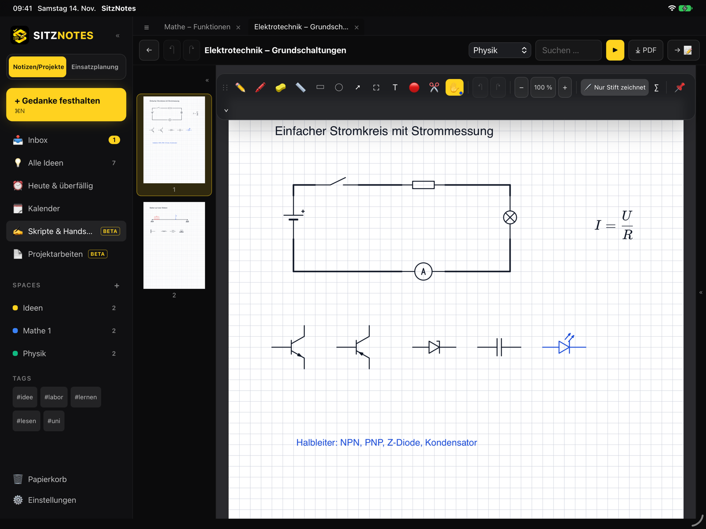
  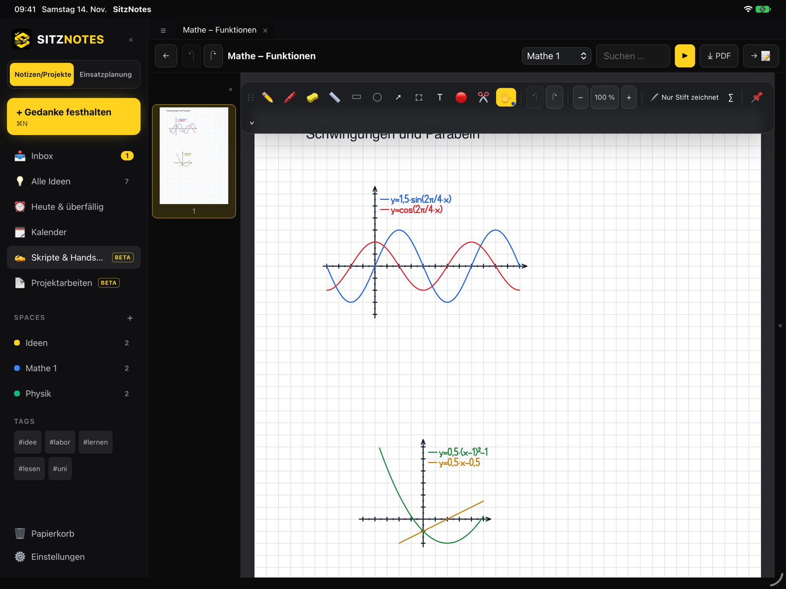

---

## Was ist SitzNotes?

SitzNotes ist eine App für alles, was dir durch den Kopf geht: schnelle Gedanken, Aufgaben, Ideen – und ganze Vorlesungsmitschriften mit Stift auf dem iPad. Ein Tastenkürzel hält einen Gedanken in Sekunden fest; sortiert wird später in Spaces, Tags und auf dem Board. Skripte importierst du als PDF und schreibst mit dem Apple Pencil direkt hinein.

Deine Daten bleiben auf deinen Geräten: kein Konto, kein Server, keine Telemetrie. PC, Mac und iPad gleichen sich auf Wunsch über deinen eigenen Ordner ab (iCloud Drive, NAS, OneDrive).

| | | |
|:--|:--|:--|
| ✍️ **Handschrift wie auf Papier** Apple Pencil mit PencilKit – Druck, Neigung, Durchkritzeln zum Löschen | 📄 **PDF-Skripte beschriften** importieren, markieren, mitschreiben, als PDF exportieren | 📈 **Koordinatensysteme & Formeln** fertige und eigene Funktionen, 3D-Flächen, LaTeX-Formeln |
| ⚡ **Schaltzeichen mit Einrasten** nach DIN EN 60617, dazu Technische Mechanik und Formen | 🖼️ **Bilder einfügen** aus Fotos, Dateien oder vom iPhone – zuschneiden und drehen | 🗂️ **Ideen-Board** Inbox, Spaces, Tags, Kanban, Kalender und Erinnerungen |
| 🔄 **Sync über deinen Ordner** iCloud Drive, NAS oder OneDrive – optional Ende-zu-Ende-verschlüsselt | 🔒 **Lokal, kein Konto** funktioniert vollständig ohne Internet | 👷 **Einsatzplanung & LaTeX** Teamplanung und Projektarbeiten mit PDF-Vorschau (Beta) |

## Neu in 0.8.2

- 🖼️ **Bilder einfügen** über einen eigenen Knopf – am iPad aus Fotos oder Dateien, am PC/Mac per Dateidialog.
- 📲 **Bilder vom iPhone** am iPad einfügen (kopieren › lange drücken › „Einfügen") und **Bilder drehen**.
- ⚡ **Symbole rasten ein:** am Raster und Anschluss an Anschluss; begradigte Linien auch auf 45°.
- 📈 **Eigene Funktionen** im Koordinatensystem, z. B. `2*sin(3x) + x^2` – auch `z = f(x, y)` in 3D.
- ↕️ **Auswahl auf eine andere Seite verschieben** – per Knopf oder durch Ziehen über den Seitenrand.
- 🧊 **3D-Körper drehen** und im Board **leere Spalten ausblenden**.

Alle Änderungen: [Patchnotes bei den Releases](https://github.com/Sitz9/sitznotes-releases/releases).

## Entwicklungsstand

SitzNotes ist eine **Beta** und wird aktiv weiterentwickelt. Windows und macOS sind im Alltag nutzbar; die iPad-App gibt es noch nicht im App Store.

| ✅ Fertig | 🔨 In Arbeit | 🗓️ Geplant |
|:--|:--|:--|
| Notizen, Inbox, Board, Kalender, Suche | Feinschliff der Gesten am iPad (zwei Finger während des Schreibens) | iPhone-App für schnelle Notizen |
| Handschrift am iPad, PDF-Skripte, Tabs, Ordner | 3D-Körper flüssiger drehen | Import aus OneNote, Goodnotes und Xournal |
| Formen, Symbole, Koordinatensysteme, Tabellen, Bilder | Direkte OneDrive-Anbindung am iPad | Vollversion als Einmalkauf (mit Version 1.0) |
| Sync über eigenen Ordner, Sicherungen, Export | Projektarbeiten (LaTeX) und Einsatzplanung – Beta | iPad-App im App Store, signierte Installer |

## Installation

Die Installer findest du unter [**Releases**](https://github.com/Sitz9/sitznotes-releases/releases/latest). Bis Version 1.0 ist SitzNotes frei testbar.

- **Windows (10/11):** `SitzNotes_<version>_x64-setup.exe` laden und starten. Meldet SmartScreen „Der Computer wurde durch Windows geschützt": **„Weitere Informationen" → „Trotzdem ausführen"** (die Installer sind noch nicht signiert).
- **macOS (ab 12, Apple Silicon und Intel):** `SitzNotes_<version>_universal.dmg` öffnen, SitzNotes nach **Programme** ziehen. Beim ersten Start: **Systemeinstellungen → Datenschutz & Sicherheit → „Dennoch öffnen"**.
- **Updates** kommen danach direkt in der App – signiert und nie ungefragt.

### iPad (Beta)

Die iPad-App hat dieselbe Oberfläche und dieselben Daten wie am PC/Mac – mit Apple Pencil, Zoomen mit zwei Fingern und Sync über die Dateien-App. Sie ist derzeit eine **Beta zum eigenen Testen** und **noch nicht im App Store** erhältlich (auch nicht über TestFlight). Sobald sie verfügbar ist, steht es hier.

<b>Installation im Detail</b> – Windows, macOS, iPad, Updates, Deinstallation

 

Die Installer findest du unter [**Releases**](https://github.com/Sitz9/sitznotes-releases/releases/latest).
Mit `SHA256SUMS.txt` kannst du prüfen, ob der Download unverändert ist.

### Windows (10/11)

1. `SitzNotes_<version>_x64-setup.exe` herunterladen und starten (alternativ das `.msi`).
2. Die Installer sind noch nicht digital signiert. Erscheint **„Der Computer wurde durch Windows geschützt"** (SmartScreen): **„Weitere Informationen" → „Trotzdem ausführen"**.
3. SitzNotes startet; das Symbol erscheint im Infobereich der Taskleiste (Tray).

### macOS (ab macOS 12, Apple Silicon und Intel)

1. `SitzNotes_<version>_universal.dmg` öffnen und SitzNotes in den Ordner **Programme** ziehen.
2. Die App ist noch nicht von Apple beglaubigt. Beim ersten Start: **Systemeinstellungen → Datenschutz & Sicherheit → „Dennoch öffnen"**.
3. Für das globale Tastenkürzel kann macOS eine Freigabe unter **Datenschutz & Sicherheit → Bedienungshilfen** verlangen.

### iPad (Beta, noch nicht im App Store)

Die iPad-App (ab 0.6.0) hat dieselbe Oberfläche und dieselben Daten wie am PC/Mac – mit **Apple Pencil und PencilKit** (Druck, Neigung, Doppeltipp, Schweben, „Nur Stift zeichnet“), Zoomen mit zwei Fingern, **mehreren Skripten als Tabs**, Rückgängig/Wiederholen über die Knöpfe ↶ ↷, Touch-Bedienung, Split View/Slide Over, Hardware-Tastatur, Mitteilungen für Erinnerungen, **Live-Diktat** mit der Spracherkennung von Apple auf dem iPad und Sync über die Dateien-App – **empfohlen: iCloud Drive** (funktioniert mit Windows, Mac und iPad), NAS-Freigaben ab 0.6.2. Eine direkte OneDrive-Anbindung (Anmeldung mit dem Microsoft-Konto) ist vorbereitet und wird in einer späteren Version freigeschaltet. Projektarbeiten lassen sich auf dem iPad bearbeiten; kompiliert wird am PC/Mac.

Sie ist derzeit eine **Beta zum eigenen Testen** und **noch nicht im App Store** erhältlich (auch nicht über TestFlight). Sobald sie verfügbar ist, steht es hier.

### Updates

**Ab Version 0.3.0 kommen Updates direkt in SitzNotes:** Gibt es eine neue Version, erscheint oben ein dezenter Hinweis
mit Versionsnummer und Neuerungen – **„Jetzt installieren"** oder **„Später"**. Es wird nie ungefragt installiert.
Selbst suchen: **Einstellungen → Updates → „Nach Updates suchen"**; die automatische Suche (beim Start und alle 6 Stunden)
lässt sich dort abschalten. Updates sind digital signiert – SitzNotes installiert nur Updates, die wirklich von SitzNotes stammen.

Von Version 0.1.0 oder 0.2.0 aus installierst du die aktuelle Version einmal von Hand: **einfach über die alte Version installieren – deine Daten bleiben erhalten**
und werden automatisch ins neue Format übernommen (Link-, Bild-, Checklisten- und Fix-Karten werden zu normalen Gedanken mit diesem Inhalt).
Nimm dafür **dasselbe Paket wie bei der ersten Installation** – wer mit dem `.msi` installiert hat, wieder das `.msi`, sonst die `setup.exe`.
In-App-Updates erkennen das selbst.

Vor jedem Update und jeder Umstellung der Datenbank legt SitzNotes automatisch eine Sicherung an
(`Sicherungen/vor-update-<version>-<datum>` im Datenordner, zusätzlich in deinem gewählten Sicherungsordner).
Geht dabei etwas schief, wird der alte Stand wiederhergestellt – SitzNotes läuft nie mit halb umgestellten Daten weiter.

### Deinstallation

Beim Deinstallieren unter Windows gibt es das Kästchen **„App-Daten löschen"** – es ist **standardmäßig aus**.
Lass es aus, wenn du deine Karten behalten möchtest. Nur wenn du es bewusst anhakst, werden der Datenordner
und die Sicherungen darin gelöscht.

## Mehr erfahren

<b>Das Besondere an SitzNotes</b>

 

- ✍️ **Handschrift wie auf Papier – mit Apples PencilKit:** Am iPad schreibst, radierst und begradigst du so direkt wie in Apple Notizen, mit Druck und Neigung. Gespeichert wird in einem offenen Vektorformat, das am Mac und PC genauso aussieht und sich als PDF exportieren lässt.
- ⚡ **Symbolpalette nach Norm:** Schaltzeichen der Elektrotechnik nach **DIN EN 60617**, Symbole der Technischen Mechanik (Lager, Einspannung, Kräfte, Lasten, Feder, Dämpfer …) und Mathematik.
  - Eingefügt werden sie am 5-mm-Raster in deiner Stiftfarbe, als saubere Vektorformen.
  - Du kannst sie frei skalieren und drehen. Bei Schaltzeichen werden beim Ziehen an der Kante nur die Anschlussleitungen länger, das Bauteil bleibt unverzerrt.
  - **Schaltpläne zeichnen (ab 0.8.0):** Leitungen rasten an den Anschlüssen der Schaltzeichen und ineinander ein – ein gelber Ring zeigt, wo.
  - **Bauteile rasten ein (ab 0.8.2):** Beim Verschieben springen Schaltzeichen auf das 5-mm-Raster und Anschluss an Anschluss aneinander.
- 📈 **Koordinatensysteme, die mitdenken:**
  - Achsen kästchenweise verlängern, Skalenstriche bleiben auf dem Raster.
  - Mehrere Funktionen in eigenen Farben, Legende mit Formel.
  - **Funktionen einstellen** (Amplitude, Periode, Verschiebung …) per Regler oder Anfasser – die Kurve folgt live.
  - **Flächen im 3D-Koordinatensystem (ab 0.8.0):** z = f(x, y) als Netz, Ansicht drehen und neigen.
  - **Eigene Funktionen (ab 0.8.2):** einfach eintippen, z. B. `2*sin(3x) + x^2` – im 3D-Koordinatensystem `z = f(x, y)`.
- 📐 **Zeichenwerkzeuge wie im Geodreieck-Mäppchen (ab 0.8.0):** Lineal mit Winkelmesser, Formen-Menü mit Flächen und Körpern (Würfel, Quader, Pyramide, Prisma, Kugel, Zylinder, Kegel).
- 🎓 **LaTeX-Projektarbeiten** mit PDF-Vorschau, verständlicher Fehleranzeige und Vorlage für wissenschaftliche Arbeiten.
- 👷 **Einsatzplanung** für Teams: Mitarbeiter, Qualifikationen, Abwesenheiten, Warnungen, Besprechungsmodus und Auswertung der letzten 12 Monate.
- 🔒 **Local-first:** Deine Daten bleiben auf deinen Geräten. Kein Konto, kein Server, keine Telemetrie. Abgleich zwischen PC, Mac und iPad über deinen eigenen Ordner (**iCloud Drive** oder **NAS**), optional Ende-zu-Ende-verschlüsselt.
- 💳 **Einmalkauf statt Abo** (mit Version 1.0): einmal kaufen, dauerhaft nutzen – die Lizenz bleibt auch offline gültig. Bis dahin ist SitzNotes frei testbar.

<b>Alle Funktionen ausführlich</b> – mit „ab Version …"

 

- **Quick Capture von überall:** Ein Tastenkürzel öffnet ein kleines Eingabefenster über allen Programmen – tippen, Enter, fertig. Der Gedanke landet in der **Inbox**.
- **Ein Gedanke kann alles enthalten:** Text, Überschriften, **Checklisten** (direkt abhakbar), Links, Tabellen, **Bilder** und **Formeln** gemischt in einem Inhalt (Markdown).
- **Einfügen-Leiste** über dem Text – Überschrift, Checkliste, Bild, Link, Fix, Formel, Tabelle, Code – oder einfach **„/" tippen** (z. B. `/checkliste`, `/formel`).
- **Formeln in LaTeX-Schreibweise:** `$E = mc^2$` im Text oder als eigener Block mit `$$ … $$`.
- **Zuordnen:** Spaces (Projekte/Themen mit Farbe und Icon), Tags (`#tag` im Text wird automatisch erkannt), Status von „Inbox" bis „Erledigt". SitzNotes schlägt passende Spaces vor („gehört wahrscheinlich zu …"). Eine Karte kann in mehreren Spaces liegen.
- **Verknüpfungen** zwischen Karten: gehört zu, inspiriert von, blockiert, Alternative zu, Teil von.
- **Synchronisation über deinen eigenen Ordner** (OneDrive, iCloud Drive, Dropbox, Google Drive oder NAS): PC und Mac bleiben automatisch auf demselben Stand – ohne Konto und ohne SitzNotes-Server, optional **Ende-zu-Ende-verschlüsselt**. Gleichzeitig auf zwei Geräten geändert? Dann gibt es eine **Konfliktkopie** statt Datenverlust.
- **Kalender & Erinnerungen:** Fälligkeit, Erinnerungen und Wiedervorlage an jeder Karte, Kalender (Monat/Woche/Agenda) mit Drag & Drop, **„Heute & überfällig"** in der Seitenleiste, Erinnerungen mit „Öffnen", „Erledigt" und „Später" – auch wenn das Fenster geschlossen ist. Export als **.ics** für Outlook, Apple oder Google Kalender.
- **Quick Capture versteht Zeitangaben** wie „morgen 9 Uhr", „Freitag" oder „in 2 Wochen" und setzt die Fälligkeit.
- **Skripte & Handschrift (Beta):** Vorlesungsskripte und Übungsblätter als **PDF importieren** oder **Notizbücher** mit leeren, linierten, karierten oder Punkt-Seiten anlegen – und mit **druckempfindlichem Stift**, **Textmarker**, **Radierer** (ganzer Strich oder nur ein Bereich), **Lineal/geraden Linien**, **Formen** und **Lasso** bearbeiten. **Seiten an jeder Stelle einfügen**, duplizieren, löschen und umsortieren – der Platz beim Rechnen geht nie aus. Zoom, Seitenübersicht, **Suche im PDF-Text**, **Export als PDF mit Handschrift** (das Original bleibt unverändert), Seite oder Ausschnitt als Bild in eine Notiz. Funktioniert mit Maus, Touch und Grafiktablett.
  - **PencilKit am iPad (ab 0.7.0):** Schreiben, Radieren (ganze Striche oder Bereiche – Schrift und begradigte Linien in einem Zug) und Begradigen wie in Apple Notizen; die Handschrift sieht am Mac und PC genauso fein aus wie am iPad (ab 0.7.5), natives Zoomen mit Vorschaubild der ganzen Seite, **Durchkritzeln zum Löschen**, Seitenformate **A0–A5 und Letter** (hoch/quer).
  - **Lange Skripte am iPad (ab 0.8.1):** Auch in importierten PDFs mit mehreren hundert Seiten bleibt das Bild beim Zoomen und Scrollen ruhig. Direkt nach dem Schreiben scrollt ein Finger sofort – auch wenn die Schreibhand liegen bleibt; der Handballen scrollt und zoomt nie.
  - **Symbolpalette (Taste ∑, ab 0.7.0):** Elektrotechnik nach DIN EN 60617, Technische Mechanik und Mathematik – mit Suche und Favoriten. Das Einfügen erfolgt am 5-mm-Raster.
  - **Koordinatensysteme mit Funktionen (ab 0.7.0):**
    - Sinus, Kosinus, Tangens, Parabel, Gerade, e-Funktion, Logarithmus, Wurzel, Hyperbel, Betrag und Glockenkurve – mehrere in einem System, jede in eigener Farbe, optional mit Legende.
    - Parameter über Regler, Zahlenfelder oder den Anfasser am Hochpunkt.
    - Achsen einzeln in Kästchenschritten verlängern.
    - **x-Achse in π-Einheiten** (π/2, π, 3π/2, 2π) für Winkelfunktionen; die Legende steht außerhalb des Diagramms (ab 0.7.5).
  - **Tabellen (Taste ▦, ab 0.7.5):**
    - Größe beim Einfügen wählen, Zeilen und Spalten hinzufügen oder löschen – auch mitten in der Tabelle.
    - Spaltenbreite und Zeilenhöhe durch Ziehen an den Linien.
    - Text per Tastatur in die Zellen (Tab springt weiter); am iPad mit dem Stift darüber schreiben.
    - Verschieben, skalieren, kopieren wie andere Objekte; im PDF-Export enthalten.
    - Zelle mit der Tastatur füllen: Finger-Doppeltipp, „✎ Zelle", Eingabe, F2 oder einfach losschreiben (ab 0.8.0).
  - **Formen-Menü (Taste ⬠, ab 0.8.0):** Rechteck, Quadrat, Dreieck, Kreis, Ellipse, Trapez, Parallelogramm, Raute, Fünf- und Sechseck; Körper: Würfel, Quader, Pyramide, Prisma, Kugel, Zylinder, Kegel.
  - **Lineal mit Winkelmesser (Taste 📐, ab 0.8.0):**
    - Mit dem Finger verschieben, an den runden Knöpfen drehen (rastet auf 15°), Winkel ablesen.
    - Stift oder Textmarker auf dem Lineal oder dicht an einer Kante ansetzen: Die Linie läuft exakt an der Kante.
    - Mit zwei Fingern drehen und verschieben (ab 0.8.1).
  - **Symbole am Raster und aneinander (ab 0.8.2):** Schaltzeichen und Formen rasten beim Verschieben auf das 5-mm-Raster ein (auch auf leeren Seiten), Schaltzeichen außerdem Anschluss an Anschluss – ein gelber Ring zeigt, wo. Abschaltbar unter Einstellungen › Skripte & Handschrift.
  - **Schaltpläne (ab 0.8.0):** Linie von Anschluss zu Anschluss ziehen und kurz halten – sie rastet an den Anschlüssen und an anderen Leitungen ein (Fang 5 mm).
  - **Eigene Funktionen (ab 0.8.2):** Koordinatensystem auswählen › „ƒ eigene" › z. B. `2*sin(3x) + x^2`, `e^(-x)`, `sqrt(x)`, `1/(x-2)`. Erlaubt sind + − · / ^, Klammern, sin, cos, tan, asin, acos, atan, sqrt, ln, log, exp, abs, π und e. Polstellen und Lücken werden sauber gezeichnet; am iPad hilft eine Formel-Leiste. Im 3D-Koordinatensystem: `z = f(x, y)`.
  - **3D-Körper drehen (ab 0.8.2):** Würfel, Quader, Pyramide, Prisma, Kugel, Zylinder oder Kegel auswählen und mit den Reglern „Drehen" und „Neigung" im Raum drehen – verdeckte Kanten passen sich an.
  - **Flächen im 3D-Koordinatensystem (ab 0.8.0):** „+ Fläche z = f(x, y)" – Paraboloid, Sattel, Ebene, Welle, Glocke, Kegel; Ansicht drehen und neigen.
  - **Symbole sind ein Objekt (ab 0.8.0):** Antippen wählt das ganze Symbol oder Koordinatensystem; Strichstärke nachträglich änderbar (╌ / ━ an der Auswahl). Formen lassen sich antippen und verschieben.
  - **Bilder einfügen (Taste 🖼️, ab 0.8.2):** iPad: „Aus Fotos" (Fotoauswahl von iOS – SitzNotes sieht nur die ausgewählten Bilder) oder „Aus Dateien"; Windows/macOS: Dateidialog. Große Fotos werden verkleinert, HEIC wird am iPad umgewandelt.
  - **Bilder vom iPhone am iPad einfügen (ab 0.8.2):** am iPhone kopieren, am iPad lange auf die Seite drücken › „Einfügen" – auch Bilder aus Fotos, Safari und Bildschirmfotos.
  - **Bilder drehen (ab 0.8.2):** ⟲ 90° / ⟳ 90° an der Auswahl oder frei am Drehgriff; der Zuschnitt bleibt, im PDF-Export steht das Bild genauso.
  - **Bild zuschneiden (ab 0.8.1):** Bild auswählen › „Zuschneiden", an Ecken und Kanten ziehen. Das Original bleibt erhalten – „Ganzes Bild" hebt den Zuschnitt wieder auf.
  - **Einzelne Wörter formatieren (ab 0.8.1):** Im Textfeld Text markieren und über die Leiste darunter fett, kursiv, unterstrichen, größer/kleiner, in anderer Schrift oder Farbe setzen – mit Vorschau; im PDF-Export als durchsuchbarer Text.
  - **Alles Ausgewählte anpassen (ab 0.7.0):** Größe über Griffe an Ecken (proportional) und Kanten (eine Richtung), stufenlos drehen über den Drehgriff – für Handschrift, Formen, Symbole, Bilder und Textfelder.
  - **Übersicht** als Kacheln mit Vorschaubild oder als Liste, sortierbar (alphabetisch, zuletzt verwendet, zuletzt geändert, erstellt).
  - **Mehrere Skripte gleichzeitig offen (ab 0.6.2):** Tabs sind nach ihrem obersten Ordner gruppiert (ab 0.8.1). Tableiste oben, jedes Skript behält Seite und Zoom, nach dem Neustart wieder da – ideal zum Kopieren aus dem Skript in die eigene Mitschrift.
  - **Ordner/Kurse:** z. B. „Mathe 1" mit Unterordnern, Farbe und Symbol, optional einem Space zugeordnet – Skripte und Notizbücher per Drag & Drop einsortieren.
  - **Auswahl auf eine andere Seite verschieben (ab 0.8.2):** über die Knöpfe an der Auswahl (vorherige Seite, nächste Seite, Seitenzahl) oder durch Ziehen über den Seitenrand – Rückgängig holt alles in einem Schritt zurück.
  - **Kopieren, Ausschneiden, Einfügen, Duplizieren:** mit dem Lasso auswählen, dann über die Leiste an der Auswahl, per Rechtsklick (bzw. langes Drücken) oder mit **Strg+C / Strg+X / Strg+V / Strg+D** – auch auf andere Seiten und in andere Notizbücher.
  - **Formerkennung durch Halten:** Strich zeichnen und am Ende kurz stillhalten – daraus wird eine saubere **Gerade** (rastet waagerecht/senkrecht und ab 0.8.2 auch auf 45° ein, ideal für Bruchstriche), ein **Kreis**, eine **Ellipse**, ein **Rechteck/Quadrat**, ein **Dreieck** oder ein **Pfeil**. **Strg+Z** holt den Strich zurück.
  - **Bereich als Bild kopieren:** Mit dem Lasso (Freihand oder Rechteck) einen Bereich auswählen – **auch Text und Abbildungen aus dem PDF** – und „Als Bild kopieren": alles im Bereich wird in hoher Auflösung samt Handschrift übernommen. Einfügen auf jeder Seite, auf leeren Seiten und in anderen Notizbüchern als verschiebbares, skalierbares Bild. Bilder und **Screenshots aus anderen Apps** fügst du mit **Strg+V** ein.
  - **Textfelder und Formeln:** Mit dem Textwerkzeug (**T**) an beliebiger Stelle schreiben oder **diktieren** – Schriftart, Größe, Farbe, fett/kursiv, Ausrichtung. **T** noch einmal ergibt ein **Formel-Textfeld** (LaTeX, z. B. `\frac{a}{b}`). Im PDF-Export als echter, **durchsuchbarer Text**; die Suche im Skript findet ihn.
  - **Werkzeuge nach Wunsch:** Ein zweiter Klick auf das aktive Werkzeug öffnet seine Einstellungen – Stiftart (**Füller, Kugelschreiber, Pinsel**), Farben mit eigener Farbauswahl und **Favoriten** (auf allen Geräten gleich), Stärke-Regler mit Vorschau, Druckempfindlichkeit, Glättung; Textmarker mit Deckkraft und „gerade Linie"; Radierer für Striche oder Bereiche, auch „nur Textmarker".
  - **Schwebende Werkzeugleiste:** schwebt über der Seite, lässt sich am Griff frei verschieben, rastet an den Rändern ein und klappt zur kleinen Pille zusammen – oder oben, unten, links bzw. rechts andocken. Seitenübersicht und Seitenleiste lassen sich einklappen.
- **Vorstellungsmodus:** Skript oder Notizbuch Seite für Seite im **Vollbild präsentieren** – auf deinem Bildschirm oder auf einem **zweiten Bildschirm bzw. Beamer**, während du auf deinem Bildschirm die **Referentenansicht** (aktuelle und nächste Seite, Zeit) steuerst. Weiter mit Pfeiltasten, Leertaste oder dem **Präsentations-Klicker**; **Laserpointer** als Punkt oder als Laserstift, dessen Striche nach kurzer Zeit verschwinden (wird nie gespeichert). Während der Präsentation kannst du normal weiterschreiben.
- **Skizze in jeder Notiz:** Baustein „Skizze" in der Einfügen-Leiste (oder `/skizze`) – kurz zeichnen, als Bild einfügen.
- **Direkt diktieren:** In jedem Textfeld (Notiz, Quick Capture, Einsatzplanung, LaTeX-Editor) auf 🎙️ klicken oder **Strg+Umschalt+D** drücken – sprechen – und der Text steht an der Cursor-Stelle, mit Satzzeichen und Großschreibung. Kürzel **gedrückt halten** = sprechen, loslassen = einfügen; **Esc** bricht ab. Optional **Dauer-Diktat**. Läuft **lokal** auf deinem Gerät, ohne Cloud; beim Diktat wird kein Audio gespeichert.
- **Sprachnotizen:** Aufnahme direkt in einer Karte (Einfügen-Leiste „Sprache" oder `/sprache`) und im Quick Capture (🎙️), mit Player. Auf Wunsch **lokal in Text umgewandelt** – auf deinem Gerät, ohne Cloud.
- **Fixes 🐞:** eigene Spalte im Board direkt nach der Inbox; über den Status-Filter siehst du nur Fehler und Korrekturen.
- **Liste und Board** (Kanban nach Status mit Drag & Drop), **Spalten auf- und zuklappbar, ausblendbar und umsortierbar**, **eigene Spalten** mit Name, Farbe und Symbol (Rechtsklick auf den Spaltenkopf); auch eingebaute Status lassen sich umbenennen, löschen und wiederherstellen (ab 0.7.5). Schiebeschalter **„Erledigte ausblenden"** und **„Leere Spalten ausblenden"** (ab 0.8.2). **Ab 0.8.0:** Bereiche in eigene Reihen untereinander legen, jede eigene Farbe, Zahl der Vorschauzeilen einstellbar, mehrere Notizen gleichzeitig auswählen und löschen, Seitenleiste der Notiz in der Breite verstellbar.
- **Spaces archivieren:** Abgeschlossenes verschwindet aus dem Alltag, bleibt im **Archiv** lesbar und lässt sich jederzeit wiederherstellen.
- **Einsatzplanung (Beta)** für Teams: Mitarbeiter mit Rolle, Qualifikationen und Abwesenheiten – **nach Rolle gruppiert** und alphabetisch, Reihenfolge der Rollen einstellbar; viele gleichartige Mitarbeiter **schnell anlegen** („Speichern & nächster" übernimmt Rolle und Qualifikationen); Aufgaben per Drag & Drop einplanen (Tag oder Woche, Schichten), auch **mit mehreren Mitarbeitern** (mit Strg ziehen = weiteren hinzufügen), **Warnungen** bei Überlastung, Abwesenheit oder fehlender Qualifikation; Zuweisungs- und Aufgabenliste als **PDF/Druck (A4 quer)** oder **CSV**; **Besprechungsmodus** im Vollbild für den Monitor in der Morgenrunde. Umschalter **„Notizen/Projekte ↔ Einsatzplanung"** oben in der Seitenleiste.
  - **Ab 0.8.0:** Qualifikationen zentral verwalten und per Mehrfachauswahl zuweisen; **Auswertung der letzten 12 Monate** (erledigte und eingeplante Aufgaben, Stunden, Abwesenheiten) als Druck/PDF oder CSV; „Daten endgültig löschen" für Mitarbeiter.
  - **Ab 0.8.1:** Der Ausdruck passt auf eine A4-Seite (automatisch verkleinert, Hoch- oder Querformat).
- **Projektarbeiten (Beta):** wissenschaftliche Arbeiten, Bachelorarbeiten und andere Dokumente in **LaTeX** schreiben – mit **PDF-Vorschau** daneben, die sich nach dem Tippen selbst erneuert, verständlicher **Fehleranzeige** (Klick springt zur Zeile), Vorlage **„Wissenschaftliche Arbeit (deutsch)"** (Titelseite, Verzeichnisse, Literatur, deutsche Silbentrennung), deinen Notizen zum Einfügen und Export als PDF oder ZIP. Bestehende LaTeX-Projekte lassen sich als Kopie importieren.
- **Volltextsuche** (auch Wortanfänge, Umlaute egal), Filter nach Status/Space/Tag, **Schnellsuche mit Strg+K**.
- **Bilder** per Drag & Drop oder Einfügen (z. B. Bildschirmausschnitt).
- **Export & Import:** alles oder einzelne Spaces als `.sitznotes`-Datei (Import führt zusammen, nichts wird doppelt) und als **Markdown + Bilder** – ein Ordner je Space, lesbar in jedem Editor oder z. B. in Obsidian.
- **Space als Gesamtdokument:** eine Datei mit allen Karten eines Space (oder aller Spaces), gegliedert nach den Board-Spalten, mit Inhaltsverzeichnis – als **PDF** oder **Markdown**.
- **Bereiche ausblenden:** Was du nicht brauchst (Projektarbeiten, Kalender, Archiv, Einsatzplanung), blendest du in den Einstellungen aus.
- **Automatische Sicherung** täglich (die letzten 10 Stände) und **vor jedem Update**.
- **Updates direkt in SitzNotes:** Hinweis mit den Neuerungen, „Jetzt installieren" oder „Später" – nie ungefragt.
- **Papierkorb für alles (ab 0.8.0):** Notizen, Skripte, Notizbücher, Ordner, Spaces und Projektarbeiten – mit „Wiederherstellen", „Endgültig löschen" und „Papierkorb leeren" (mit Sicherheitsabfrage), auf Wunsch automatisch nach einer gewählten Zahl von Tagen.
- **Passt sich deinem Monitor an:** von Laptop bis 4K, mit jeder Windows-Skalierung und auf Retina-Displays. Die Seitenleiste lässt sich auf eine schmale Leiste mit dem Logo einklappen (**Strg+B**).
- **Hell- und Dunkelmodus (ab 0.8.0):** System, Hell oder Dunkel unter Einstellungen → Darstellung. Alle Links öffnen im Standard-Browser.

<b>Bildschirmfotos</b> – Liste, Board, Skripte, Kalender, Einsatzplanung, Projektarbeit

 

  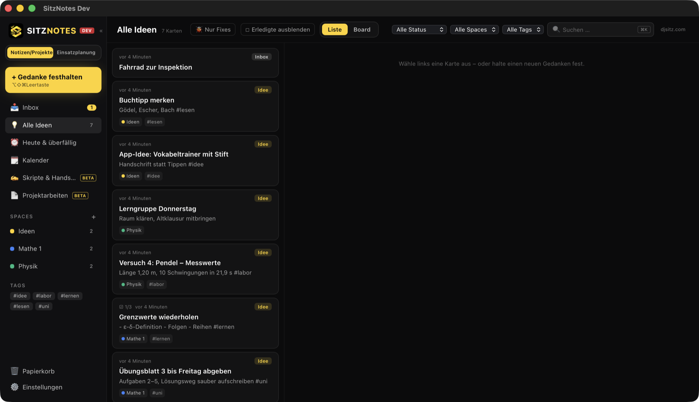 
  alle Ideen als Liste mit Spaces und Tags

  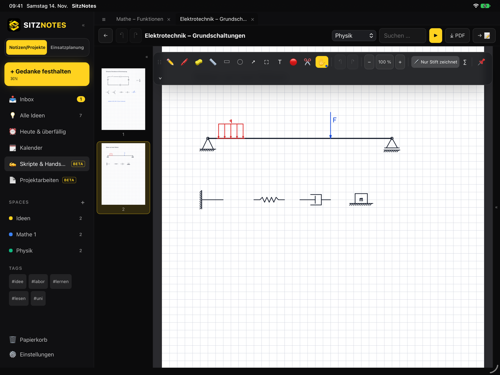 
  iPad: Balken auf Fest- und Loslager mit Streckenlast und Einzelkraft, Einspannung, Feder, Dämpfer, Masse

  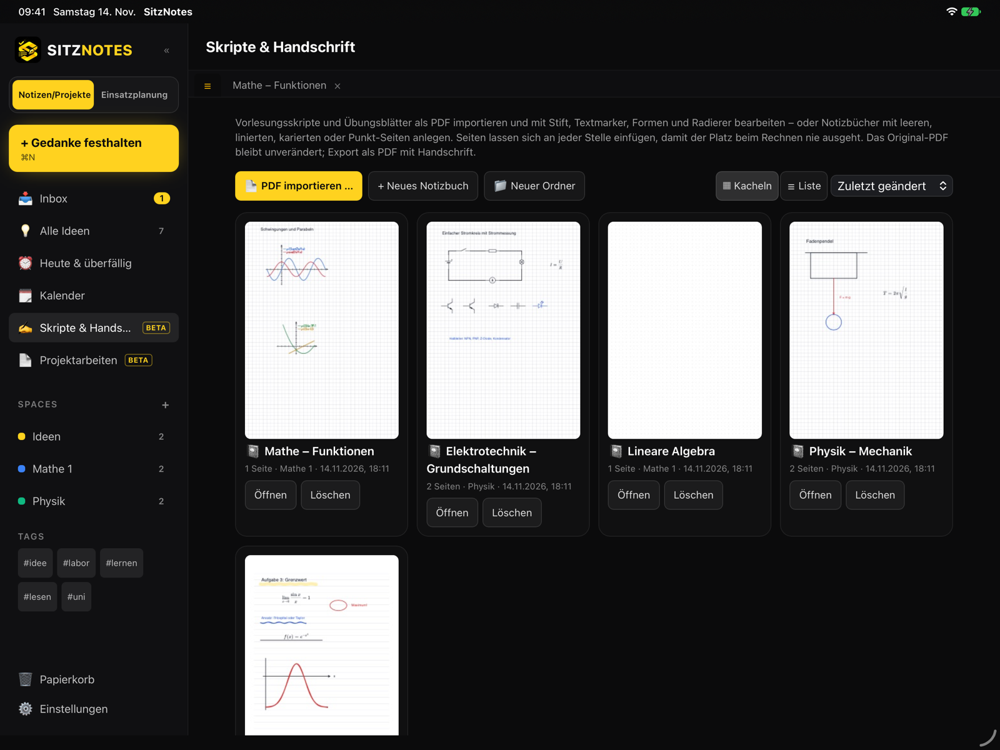 
  iPad: Skripte und Notizbücher als Kacheln mit Vorschaubild

  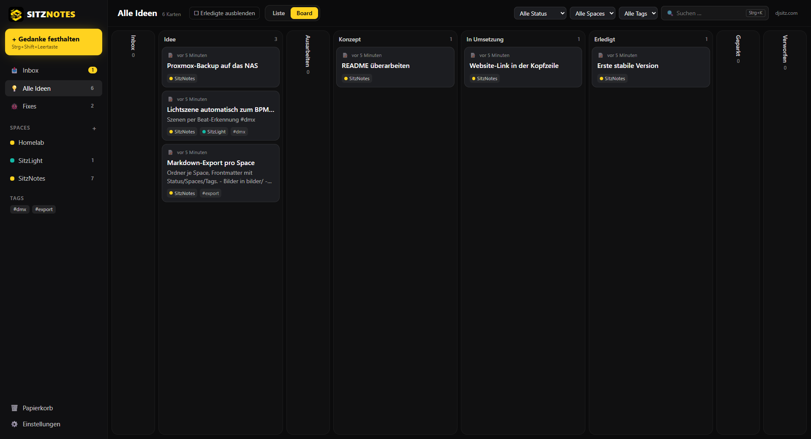 
  Board nach Status mit Fixes-Spalte

  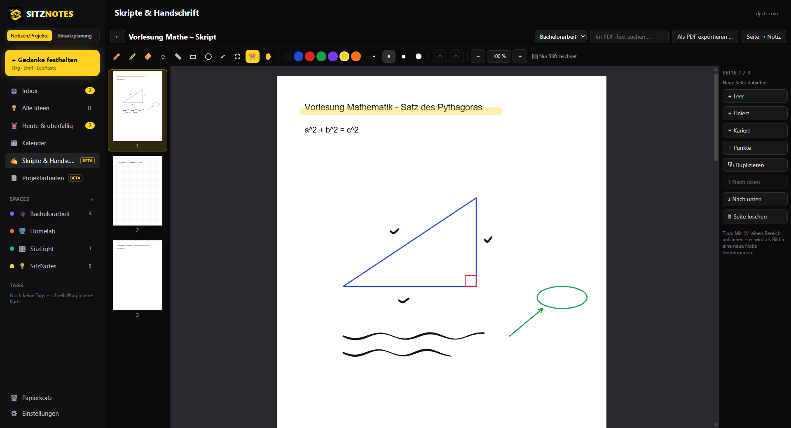 
  Vorlesungsskript mit Handschrift, Textmarker und Formen (Beta)

  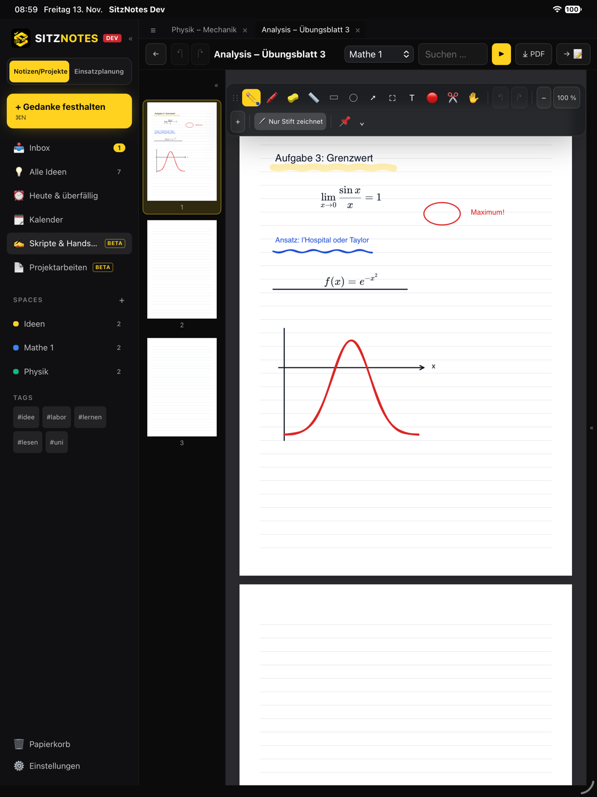 
  iPad: zwei Skripte als Tabs, Formeln, Formen und Textmarker

  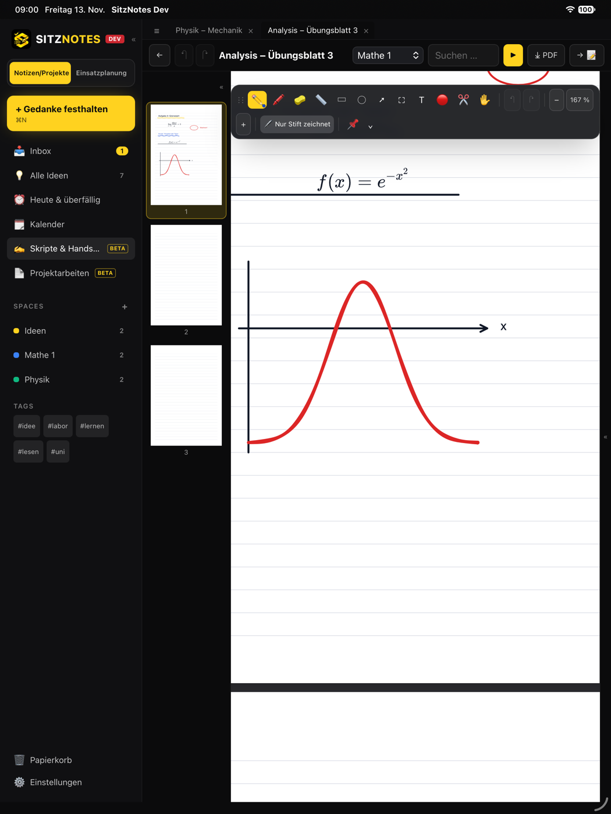 
  iPad: mit zwei Fingern gezoomt – scharf bei 167 %

  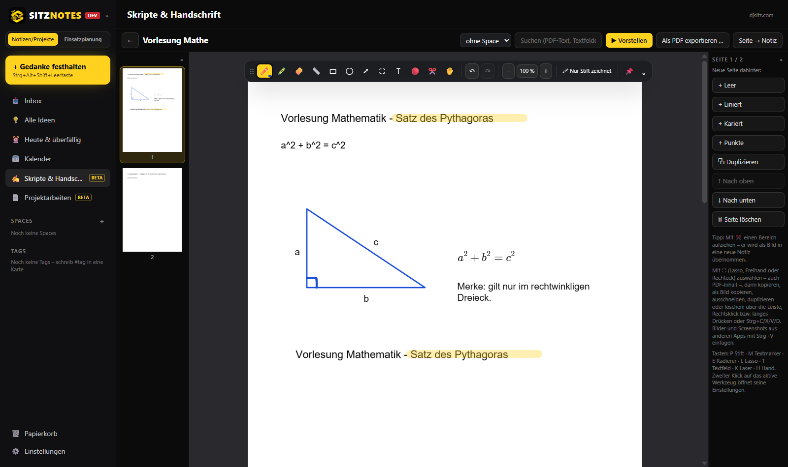 
  Skript mit Handschrift, Textfeldern und Formel – schwebende Werkzeugleiste

  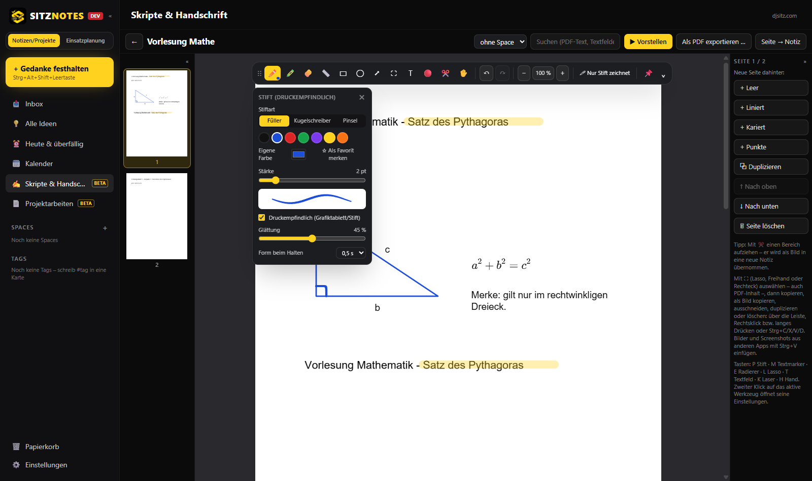 
  Stift-Einstellungen mit Stiftart, Farben, Favoriten und Stärke

  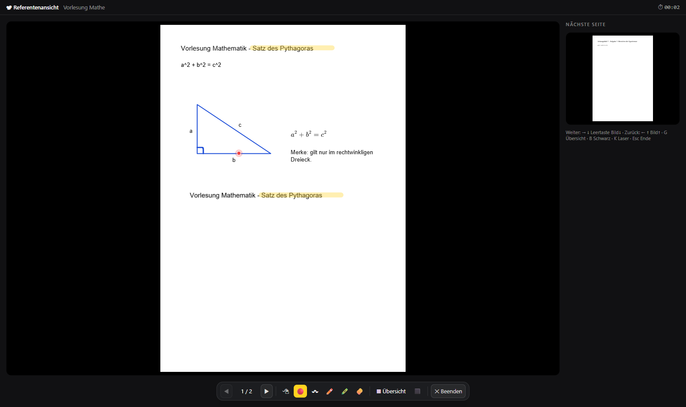 
  Vorstellungsmodus – Referentenansicht mit Laserpointer

  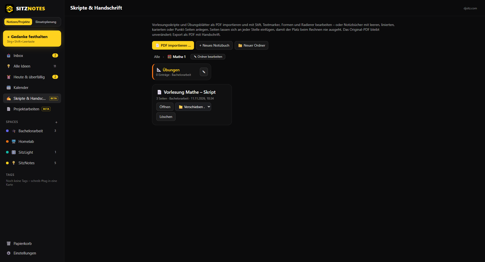 
  Ordner für Vorlesungen in „Skripte & Handschrift“

  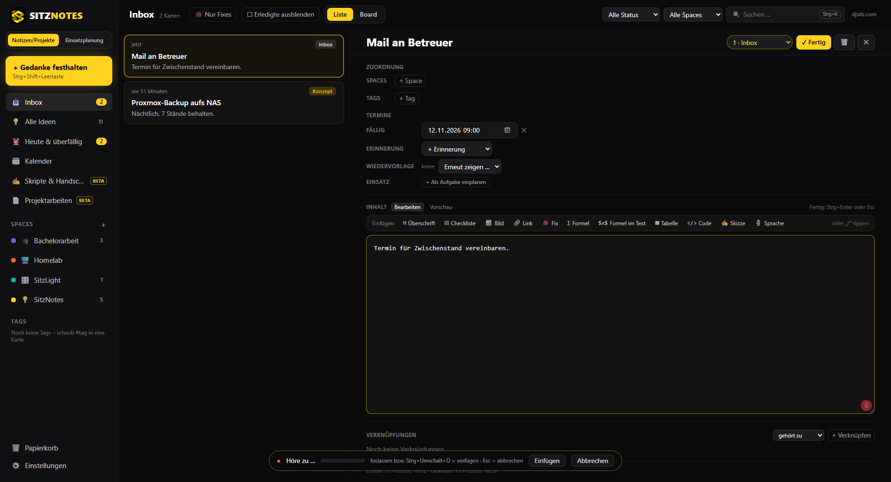 
  Direkt diktieren – „Höre zu …“ in einer Notiz

  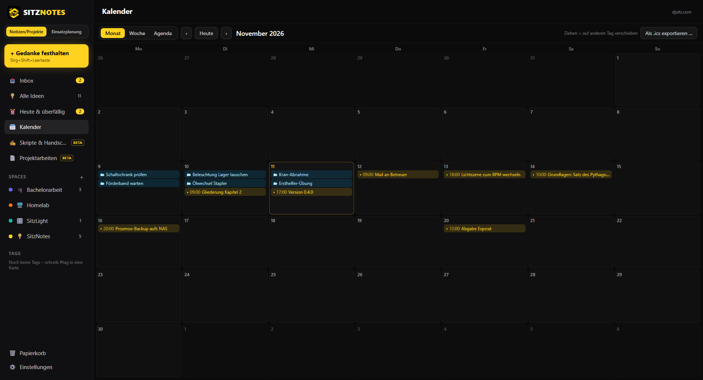 
  Kalender mit Fälligkeiten und Aufgaben

  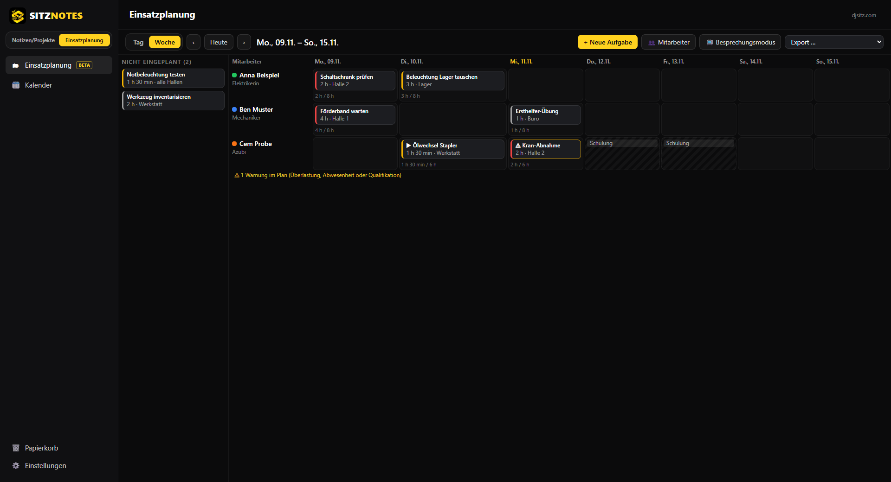 
  Einsatzplanung – Mitarbeiter nach Rollen, Aufgaben mit mehreren Mitarbeitern

  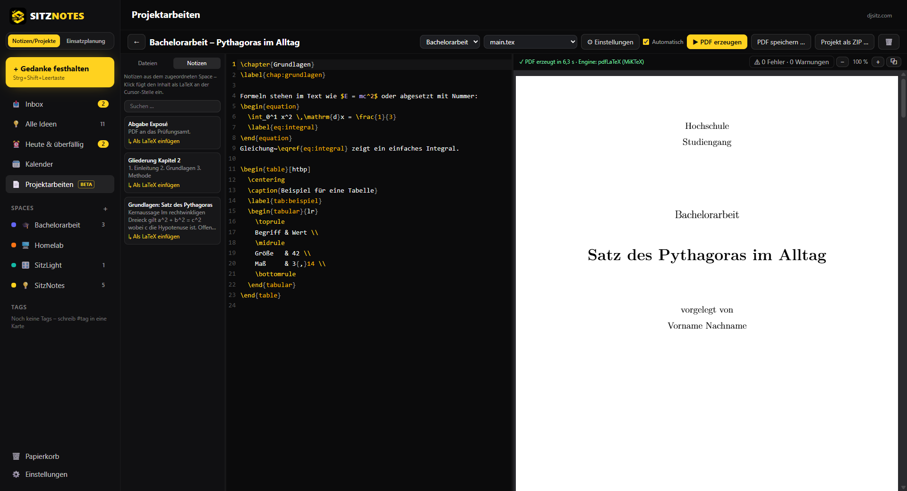 
  Projektarbeit mit LaTeX-Editor und PDF-Vorschau (Beta)

<b>Tastenkürzel</b>

 

| Kürzel | Wirkung |
|---|---|
| **Strg+Shift+Leertaste** (Windows) · **⌥⇧Leertaste** (macOS) | Quick Capture von überall (in den Einstellungen änderbar) |
| **Enter** / **Shift+Enter** / **Esc** | im Quick Capture: speichern / neue Zeile / schließen |
| **Strg+N** oder **N** | neue Karte |
| **Strg+K** | Schnellsuche über alle Karten |
| **↑ / ↓** (oder J / K) | durch die Liste bewegen |
| **S** / **T** | Space bzw. Tag zuordnen |
| **1 – 9** | Status setzen (Inbox, Fixes, Idee … Verworfen) |
| **Enter** | Vorschlag „gehört wahrscheinlich zu …" annehmen |
| **Entf** | in den Papierkorb |
| **Strg + Klick** · am Tablet **lange halten** | mehrere Notizen auswählen (**Entf** löscht die Auswahl, **Esc** beendet sie) |
| **Strg+Enter** oder **Esc** | beim Bearbeiten: **Fertig** |
| **/** | beim Bearbeiten: Baustein einfügen (Checkliste, Formel, Bild …) |
| **Strg+S** | in einer Projektarbeit: speichern und PDF sofort erzeugen |
| **Rechtsklick** auf einen Spaltenkopf | Board: Spalte ausblenden, verschieben, Spalten anpassen |
| **Eingabe** / **F2** / einfach tippen (Tabelle ausgewählt) | Skripte: Tabellenzelle bearbeiten |
| **Strg+B** | Seitenleiste ein-/ausklappen |
| **Strg + Mausrad** (Windows) · **⌘ + Mausrad** / Trackpad-Pinch (macOS) · zwei Finger (iPad) | in Skripten zoomen – der Punkt unter Maus bzw. Fingern bleibt stehen |
| **Zwei Finger tippen** / **drei Finger tippen** (iPad) | in Skripten: rückgängig / wiederholen |
| **Strg+Z** / **Strg+Y** | in Skripten & Notizbüchern: rückgängig / wiederholen |
| **Strg+W** / **Strg+Tab** / **Strg+Umschalt+Tab** (macOS: **⌘W**, **⌘⇧]** / **⌘⇧[**) | Skripte: Tab schließen / nächster / vorheriger Tab |
| **P** / **M** / **E** / **L** / **T** / **K** / **H** | Skripte: Stift / Textmarker / Radierer / Lasso / Textfeld / Laserpointer / Hand |
| **L** bzw. **T** noch einmal | Lasso Freihand ↔ Rechteck bzw. Textfeld ↔ Formel |
| Zweiter Klick auf das aktive Werkzeug | Einstellungen des Werkzeugs (Stiftart, Farbe, Stärke …) |
| **Esc** / **Strg+Enter** | Textfeld übernehmen; **Strg+B** / **Strg+I** darin: fett / kursiv |
| **Umschalt** beim Ziehen | gerade Linie bzw. Pfeil in 15°-Schritten |
| **Strg+C** / **Strg+X** / **Strg+V** / **Strg+D** / **Entf** | Lasso-Auswahl kopieren / ausschneiden / einfügen / duplizieren / löschen |
| **Rechtsklick** bzw. **langes Drücken** auf eine Seite | Menü: Kopieren, Ausschneiden, Duplizieren, Löschen, Einfügen |
| Am Strichende **kurz stillhalten** | begradigen: Linie (waagerecht/senkrecht rastet ein, auch lange Bruchstriche), Kreis, Ellipse, Rechteck, Dreieck, Wurzelzeichen; Pfeil nur mit gezeichneter Spitze. **Danach weiterziehen:** Linie verlängern/drehen, Formen vergrößern – solange der Stift aufliegt |
| Auswahl mit **Finger oder Stift ziehen** · **Tipp daneben** | Auswahl (auch Eingefügtes) verschieben · Auswahl aufheben |
| **Strg+Umschalt+D** (halten oder drücken) | in jedem Textfeld diktieren (in den Einstellungen änderbar), **Esc** bricht ab |
| **Strg** beim Ziehen einer Aufgabe | Einsatzplanung: weiteren Mitarbeiter hinzufügen |
| **← / →** | im Besprechungsmodus: Tag bzw. Woche blättern (**Esc** beendet) |
| **→ ↓ Leertaste Bild↓** / **← ↑ Bild↑** | Vorstellungsmodus: weiter / zurück (auch Präsentations-Klicker) |
| **G** / **B** / **Pos1** / **Ende** / **Esc** | Vorstellungsmodus: Seitenübersicht / schwarzer Bildschirm / erste / letzte Seite / beenden |
| **Esc** | Karte schließen |

Auf dem Mac jeweils **⌘** statt **Strg**.

<b>Tipps zur Nutzung</b>

 

- **Erst festhalten, später sortieren.** Mit dem Quick-Capture-Kürzel schreibst du den Gedanken in Sekunden auf, ohne das aktuelle Programm zu verlassen. Die erste Zeile wird zum Titel, der Rest zum Inhalt.
- **Schreiben mit Apple Pencil (iPad):** „Nur Stift zeichnet" ist von Anfang an an – die Hand darf aufliegen, mit dem Finger scrollst und zoomst du. Doppeltipp auf den Pencil wechselt zum Radierer und zurück; hältst du den Stift knapp über das Display, zeigt ein Kreis die Spitze bzw. die Radierergröße.
- **Deine Farbe:** Unter **Einstellungen → Darstellung** wählst du die Akzentfarbe der App. Mit den **Seitentasten der Maus** (Zurück/Vor) wechselst du zwischen den zuletzt geöffneten Ansichten.
- **Tabellen in der Mitschrift:** Tabelle mit ▦ einfügen, mit dem Lasso auswählen und über die Marken oben/links eine Spalte oder Zeile wählen – dann davor oder dahinter einfügen. Für Text doppelt in eine Zelle klicken oder das Text-Werkzeug nehmen.
- **Gerade Linien mit dem Lineal:** 📐 einschalten, Lineal mit dem Finger hinlegen und drehen, dann mit dem Stift an der Kante entlangziehen. Der Winkel steht in der Mitte.
- **Foto von der Tafel ins Skript:** Am iPad 🖼️ › „Aus Fotos" – oder am iPhone fotografieren, kopieren und am iPad lange auf die Seite drücken › „Einfügen". Danach zuschneiden und drehen.
- **Kein Platz mehr auf der Seite?** Rechnung mit dem Lasso auswählen und mit „⇣ Seite" auf die nächste Seite schieben.
- **Abbildung passend machen:** Eingefügtes Bild antippen › „Zuschneiden" – so bleibt nur der Teil der Folie stehen, den du brauchst. Das ganze Bild kannst du jederzeit zurückholen.
- **Wichtiges hervorheben:** In einem Textfeld ein Wort markieren und fett oder farbig setzen, statt ein zweites Textfeld anzulegen.
- **Beim Schreiben weiterblättern:** Die Schreibhand kann liegen bleiben – mit einem Finger der anderen Hand scrollst du sofort weiter.
- **Schaltplan in zwei Minuten:** Schaltzeichen über ∑ › Elektrotechnik einfügen, dann Leitungen von Anschluss zu Anschluss ziehen und am Ende kurz halten – der gelbe Ring zeigt, dass die Leitung sitzt.
- **Hell für draußen, Dunkel für abends:** Einstellungen → Darstellung → System / Hell / Dunkel.
- **Inbox-Routine:** Einmal am Tag die Inbox öffnen und mit der Tastatur durchgehen – **S** für den Space, **T** für Tags, **1–9** für den Status, **Enter** übernimmt den Vorschlag. Ziel: Inbox leer.
- **Alles in einen Gedanken:** Notiz schreiben, mit **/checkliste** Aufgaben dazu, ein Bildschirmfoto mit **Strg+V** direkt an die Stelle, eine Formel mit **/formel** – in der Vorschau hakst du Aufgaben direkt ab.
- **Spaces für Projekte, Tags für Querschnittsthemen.** Ein Space ist z. B. „Homelab" oder „Musik", ein Tag z. B. `#idee-für-später` oder `#kaufen` – Tags schreibst du einfach mit `#` in den Text.
- **Fehler gehören zu den Fixes.** Beginnt eine Quick-Capture-Notiz mit `fix:`, landet sie in der Spalte „🐞 Fixes". Über den **Status-Filter** siehst du alle offenen Fehler, zusammen mit dem Space-Filter nur die eines Projekts.
- **Board für den Überblick:** Karten per Drag & Drop in die nächste Spalte ziehen; Spalten, die du gerade nicht brauchst, per Klick auf den Spaltenkopf zuklappen; „Erledigte ausblenden" hält das Board übersichtlich.
- **Projektarbeit neben den Notizen:** Ordne die Projektarbeit dem Space mit deinen Recherche-Notizen zu – unter „Notizen" stehen sie neben dem Editor und lassen sich per Klick als LaTeX einfügen. Bilder einfach in die Dateiliste oder den Editor ziehen.
- **Verknüpfen statt kopieren:** Gehört eine Idee zu einer anderen, verknüpfe sie – in beiden Karten ist die Verbindung sichtbar.
- **Diktieren statt tippen:** In jedes Textfeld klicken und **Strg+Umschalt+D gedrückt halten**, sprechen, loslassen – fertig. Für Umbrüche „neue Zeile" bzw. „neuer Absatz" sagen. Ab 0.6.1 erscheint der Text bei längeren Diktaten nach jeder kurzen Sprechpause (**Dauer-Diktat**, in den Einstellungen abschaltbar). Auf dem **iPad** auf 🎙️ tippen: Der Text erscheint live beim Sprechen. Alternativ funktioniert auch das Diktieren des Systems (**Windows: Win+H**, **macOS:** zweimal **Fn** bzw. **Globus-Taste**). Für längere Gedanken unterwegs: **🎙️ im Quick Capture** – die Aufnahme landet in der Inbox, mit Sprachmodell gleich als Text.
- **Sprache in Text – lokal:** Einstellungen → **„Sprache & Diktat"** → Modell laden („Genauer", ca. 180 MB, empfohlen – oder „Schnell", ca. 57 MB). Die Größe siehst du vor dem Download; danach läuft alles offline. Mit „automatisch umwandeln" steht der Text direkt unter jeder Aufnahme. Ist dir das Diktat zu langsam, wähle dort „Schnell".
- **Ein Ordner je Vorlesung:** In „Skripte & Handschrift" einen Ordner pro Kurs anlegen und ihm den Space des Kurses geben – neue Skripte darin landen automatisch im richtigen Space.
- **Saubere Skizzen ohne Lineal:** Bruchstrich, Achsen oder Kästen einfach zeichnen und am Ende kurz stillhalten. Rechenweg auf eine neue Seite übernehmen: mit dem Lasso auswählen, **Strg+C**, auf der neuen Seite **Strg+V**.
- **Skript in der Vorlesung:** PDF importieren, mit dem **Textmarker** markieren, mit dem **Stift** mitschreiben; wird es eng, unter der Seite „+ Kariert" einfügen und dort weiterrechnen. Am Ende **„Als PDF exportieren"** für eine Kopie mit allen Notizen.
- **Mit Grafiktablett oder Touchscreen:** Sobald ein Stift erkannt wird, schaltet sich **„Nur Stift zeichnet"** ein – Finger blättern dann nur (Handballen-Schutz).
- **Abbildung aus dem Skript übernehmen:** Lasso auf **Rechteck** stellen (Taste **L** zweimal), die Abbildung oder Formel im PDF umrahmen, **„Als Bild kopieren"** – auf einer leeren Seite **Strg+V** und daneben weiterrechnen. Das Original-PDF bleibt unverändert.
- **Tippen statt schreiben, wo es sauber sein soll:** Mit **T** ein Textfeld für Überschriften oder Merksätze setzen, mit **T** noch einmal eine Formel; mit **Strg+Umschalt+D** auch direkt hineindiktieren.
- **Lieblingsfarben merken:** Im Stift-Menü eine eigene Farbe wählen und mit **☆** als Favorit merken – sie steht dann auch auf deinen anderen Geräten zur Verfügung.
- **Präsentieren mit Beamer:** Beamer anschließen (Windows: **Win+P** → „Erweitern", macOS: Systemeinstellungen → Displays), dann im Skript **„▶ Vorstellen"** → den zweiten Bildschirm wählen. Auf deinem Bildschirm siehst du die nächste Seite und die Zeit; der Klicker blättert. Mit **B** wird der Beamer kurz schwarz, mit **G** springst du über die Seitenübersicht zu jeder Seite.
- **Laserpointer zum Erklären:** Taste **K** – als Punkt zeigt er, als Laserstift (im Menü „Spur") malst du Kreise und Pfeile, die von selbst wieder verschwinden.
- **Mehr Platz auf kleinen Bildschirmen:** Seitenleiste mit **Strg+B** einklappen, Seitenübersicht und Seitenleiste im Skript mit **«** / **»** zuklappen, die Werkzeugleiste zur Pille einklappen.
- **Sicherungsordner außerhalb des App-Datenordners wählen** (Einstellungen → Sicherungsordner), z. B. **Dokumente**, ein **NAS** oder ein Cloud-Ordner. Dann überstehen deine Sicherungen auch eine Deinstallation oder einen Rechnerwechsel.
- **PC und Mac synchron halten:** Einmal einen gemeinsamen Ordner einrichten (siehe „Synchronisation" unten) – danach musst du nichts mehr tun. Ohne Sync geht es weiterhin per Export/Import: auf dem einen Gerät „Alles exportieren (.sitznotes)", auf dem anderen importieren.
- **Termine direkt beim Festhalten:** Schreib im Quick Capture z. B. „Mail an Betreuer morgen 9 Uhr" – SitzNotes erkennt die Zeit, zeigt sie vor dem Speichern an und erinnert dich pünktlich. Mit ✕ in der Vorschau übernimmst du die Zeitangabe nicht.
- **Wiedervorlage statt Vergessen:** Ideen, die gerade nicht dran sind, mit „Wiedervorlage in 14 Tagen" versehen – sie tauchen dann unter „Heute & überfällig" wieder auf.
- **Board nach deinem Ablauf:** Spalten, die du nie brauchst (z. B. „Verworfen"), ausblenden; eigene Spalten wie „Warten auf Rückmeldung" anlegen. Karten in ausgeblendeten Spalten gehen nie verloren.
- **Fertige Projekte archivieren** statt löschen – das Archiv bleibt durchsuchbar („Archiv einbeziehen" neben der Suche).
- **Morgenrunde im Team:** In der Einsatzplanung den **Besprechungsmodus** auf den großen Monitor bringen; Zuweisungsliste vorher als PDF für den Aushang speichern.
- **Team schnell erfassen:** Erst alle Mitarbeiter einer Rolle hintereinander anlegen (Rolle und Qualifikationen einmal eintragen, dann nur noch Name + Enter), dann die nächste Rolle. Mit ↑/↓ legst du fest, welche Rolle oben steht.
- **Rückblick fürs Team:** Einsatzplanung → Export → „Auswertung letzte 12 Monate". Krankheitstage sind nur enthalten, wenn du den Haken ausdrücklich setzt.
- **Markdown-Export** (Einstellungen oder Space-Menü „⋯") für eine lesbare Kopie: ein Ordner je Space, Bilder im Unterordner `bilder`, Fixes im Unterordner `Fixes`.
- **Papierkorb aufräumen:** Gelöschtes (Notizen, Skripte, Ordner, Spaces, Projektarbeiten) liegt im Papierkorb, bis du es endgültig löschst („Papierkorb leeren"). Wer möchte, stellt in den Einstellungen „Automatisch leeren nach … Tagen" ein – standardmäßig ist das aus.

<b>Synchronisation</b> – OneDrive, iCloud Drive, NAS

 

SitzNotes gleicht mehrere Geräte über einen **Ordner** ab, den du schon hast. Es gibt kein Konto und keinen SitzNotes-Server – den Transport übernimmt dein Cloud-Dienst bzw. dein Netzwerk. Jedes Gerät behält alle Daten lokal und funktioniert auch offline.

**Empfehlung für Windows, Mac und iPad: iCloud Drive** (Windows mit „iCloud für Windows“ aus dem Microsoft Store) – funktioniert auf allen drei Geräten.

1. Einen **eigenen, leeren Unterordner** anlegen, z. B. `OneDrive\SitzNotes-Sync` oder `iCloud Drive/SitzNotes-Sync` oder eine Freigabe auf dem NAS.
   **OneDrive:** Rechtsklick auf den Ordner → **„Immer auf diesem Gerät beibehalten"**. **iCloud Drive:** im Finder „Immer behalten" bzw. „Laden".
2. **Einstellungen → Synchronisation → „Sync einrichten …"** → Ordner wählen → Gerätenamen prüfen.
3. **Ende-zu-Ende-Verschlüsselung** (empfohlen): Sync-Passwort vergeben und gut aufbewahren – es wird für jedes weitere Gerät gebraucht. Dein Cloud-Anbieter sieht dann nur verschlüsselte Dateien.
4. Auf dem nächsten Gerät **denselben Ordner** wählen (der Pfad darf anders sein) und das Sync-Passwort eingeben. Beim ersten Abgleich zeigt SitzNotes eine Vorschau, legt eine Sicherung an und führt **beide Bestände verlustfrei zusammen**.

Danach gleicht SitzNotes automatisch ab: beim Start, alle paar Minuten, kurz nach deinen Änderungen, wenn der Cloud-Dienst Neues bringt, und beim Beenden. Das Symbol unten in der Seitenleiste zeigt den Stand (✓ aktuell, ↻ synchronisiert, ⚠ Problem – mit Erklärung).

- **Gleichzeitig bearbeitet?** Die neuere Fassung bleibt an der Karte, die andere erscheint als „… (Konfliktkopie – Gerätename)" daneben.
- **Ordner nicht erreichbar** (NAS aus, unterwegs)? Weiterarbeiten – SitzNotes holt alles nach, sobald der Ordner wieder da ist.
- **Nicht synchronisiert** werden gerätespezifische Dinge: Tastenkürzel, Fensterpositionen, Sicherungen, ausgeblendete Bereiche, die LaTeX-Engine und „Externe Programme erlauben" einer Projektarbeit.
- Sync ist **keine Sicherung**: Löschen wird ebenfalls übertragen. Die automatischen Sicherungen laufen weiter.
- Sync ausschalten oder ein Gerät entfernen geht jederzeit – lokale Daten bleiben erhalten.
- **iPad (Beta):** In SitzNotes › Einstellungen › Synchronisation › „Ordner in der Dateien-App" den Sync-Ordner antippen (iCloud Drive oder NAS-Freigabe). SitzNotes merkt sich den Ordner dauerhaft. Weil iPadOS keine Ordnerüberwachung im Hintergrund erlaubt, gleicht das iPad beim Öffnen und Zurückkehren in die App, alle paar Minuten, beim Verlassen und beim **Nach-unten-Ziehen** in der Liste ab. **OneDrive** lässt sich in der Dateien-App nicht als Ordner für andere Apps freigeben – die direkte OneDrive-Anbindung folgt; bis dahin iCloud Drive nutzen. **NAS-Freigaben (SMB)** funktionieren ab 0.6.2 auch am Mac und iPad (in der Dateien-App als registrierter Benutzer verbinden, nicht als Gast). Begleitdateien von macOS/NAS („._…“, „.DS_Store“) stören nicht.
- **Ausgabe-PDFs der Projektarbeiten (ab 0.6.0, Standard aus):** Einstellungen › Synchronisation › „Ausgabe-PDFs der Projektarbeiten mitsynchronisieren" – das zuletzt am PC/Mac erzeugte PDF liegt (verschlüsselt) im Sync-Ordner und lässt sich z. B. auf dem iPad ansehen.
- **Verschiedene Versionen auf den Geräten (ab 0.5.2):** Ein Gerät mit älterer Version synchronisiert weiter, auch wenn ein anderes schon neuere Funktionen nutzt – neue Inhalte (z. B. Textfelder oder Bilder in Skripten) werden aufbewahrt und weitergegeben, nichts wird überschrieben. Anzeigen kann das ältere Gerät sie erst nach dem Update. In den Sync-Einstellungen siehst du, welches Gerät eine neuere oder ältere Version nutzt. Trotzdem empfohlen: **alle Geräte zeitnah aktualisieren.**
- Ein Gerät mit **0.5.0** meldet bei Daten neuerer Versionen weiterhin **„Bitte SitzNotes aktualisieren"** und gleicht bis zum Update nichts ab – es überschreibt nichts, und seine Änderungen werden nach dem Update übertragen.

<b>Projektarbeiten (Beta) – LaTeX</b>

 

- **Neue Projektarbeit:** Seitenleiste → **Projektarbeiten** → „Neue Projektarbeit", Vorlage **„Wissenschaftliche Arbeit (deutsch)"** oder **„Leer"** wählen.
- **LaTeX-Engine:** Ist **MiKTeX**, **TeX Live** oder **MacTeX** installiert, nutzt SitzNotes diese automatisch – **empfohlen** (siehe unten). Ohne Distribution kommt das mitgelieferte **Tectonic** als Notlösung für einfache Dokumente zum Einsatz: Beim ersten PDF lädt es benötigte Pakete einmalig (etwa 40 MB), danach offline. Engine je Projektarbeit unter **Einstellungen** wählbar (automatisch, pdfLaTeX, XeLaTeX, LuaLaTeX, Tectonic).
- **Literatur, Glossare, Verzeichnisse:** biblatex/Biber (z. B. `style=apa`) und BibTeX, Glossare, Abkürzungs- und Symbolverzeichnisse (auch eigene) erzeugt SitzNotes automatisch und kompiliert so oft, bis alle Verweise stimmen – ohne dass Perl nötig ist.
- **minted & Co.:** In den Einstellungen der Projektarbeit „**Externe Programme erlauben**" einschalten (Standard aus – nur für eigene, vertrauenswürdige Projekte). Dafür Python 3 installieren.
- **Fehlerleiste** am unteren Rand der PDF-Vorschau: schließbar, über „⚠ … Fehler · … Warnungen" wieder zu öffnen, Fehler/Warnungen filterbar, Klick springt zur Stelle.
- **Vorschau abdocken** (⧉) für den zweiten Monitor; Dateiliste und Vorschau per Trennlinie breiter oder schmaler ziehen.
- **Import:** „Ordner importieren" bzw. „ZIP importieren" übernimmt ein bestehendes LaTeX-Projekt als **Kopie** – deine Originaldateien werden nie verändert.
- **Sicherung:** Projektarbeiten sind in den automatischen Sicherungen, den Sicherungen vor Updates und im `.sitznotes`-Export enthalten.
- Es ist eine **Beta**: Bitte bei wichtigen Arbeiten zusätzlich regelmäßig „Projekt als ZIP" exportieren und Fehler als Issue melden.

**LaTeX installieren**

Für Projektarbeiten wird eine **vollständige LaTeX-Distribution** empfohlen – **Windows: MiKTeX**, **macOS: MacTeX**.
Das mitgelieferte Tectonic ist nur eine Notlösung (keine pdfTeX-Befehle wie `\pdfminorversion`, kein Biber, kein minted).
Die gleiche Anleitung zeigt SitzNotes unter Projektarbeiten → „Anleitung anzeigen".

**Windows (MiKTeX)**

1. Installer von [miktex.org/download](https://miktex.org/download) laden und starten.
2. „Nur für mich" installieren, „Fehlende Pakete automatisch installieren" = **Ja**.
3. MiKTeX Console öffnen → **Nach Updates suchen** → installieren → unter Tasks **„Refresh file name database"**.
4. SitzNotes neu starten.

**macOS (MacTeX)**

1. Paket von [tug.org/mactex](https://www.tug.org/mactex/) laden (mehrere GB) und installieren.
2. Mit dem **TeX Live Utility** alle Aktualisierungen installieren.
3. SitzNotes neu starten.

Kleinere Alternative: [BasicTeX](https://www.tug.org/mactex/morepackages.html) – dann müssen benötigte Pakete nachinstalliert werden.

**Optional für minted:** [Python 3](https://www.python.org/downloads/) installieren (Windows: „Add python.exe to PATH" anhaken), Paket `latexminted` über die Distribution installieren und in der Projektarbeit „Externe Programme erlauben" einschalten.

**Prüfen:** Nach dem Kompilieren steht in der Kopfzeile der PDF-Vorschau „Engine: pdfLaTeX (MiKTeX)" bzw. „(TeX Live)" / „(MacTeX)".

**Problemlösung:** Seltsame Fehler nach Updates (z. B. `\insert@pcolumn` bei Tabellen) → MiKTeX Console: Updates + „Refresh file name database"; hartnäckige Fälle in der Eingabeaufforderung `initexmf --update-fndb` und `initexmf --dump`. macOS: TeX Live Utility → Aktualisieren.

<b>Datenschutz</b> – alles bleibt lokal

 

- Alle Karten, Bilder, Projektarbeiten und Einstellungen liegen **nur lokal** auf deinem Gerät (Windows: `%APPDATA%\de.sitzmedia.sitznotes`, macOS: `~/Library/Application Support/de.sitzmedia.sitznotes`).
- **Kein Konto, kein Server, keine Telemetrie.** SitzNotes funktioniert vollständig ohne Internet.
- **Diktat:** Was du diktierst, wird lokal in Text umgewandelt – es wird kein Audio gespeichert oder übertragen.
- **Sprachaufnahmen** bleiben auf deinem Gerät (und in deinem Sync-Ordner). Die Umwandlung in Text läuft **lokal** (whisper.cpp). Das Sprachmodell wird **nur nach deiner Zustimmung** einmalig von huggingface.co geladen; dabei werden keine Daten von dir übertragen. Das Modell wird nicht synchronisiert und lässt sich jederzeit entfernen.
- Ins Internet geht SitzNotes nur für die **Update-Suche** (eine kleine Abfrage bei GitHub, abschaltbar) und – nur wenn du Projektarbeiten mit dem mitgelieferten Tectonic nutzt – zum einmaligen Laden von LaTeX-Paketen. Dabei werden keine Daten von dir übertragen.
- **Sync** läuft nur über den Ordner, den du selbst wählst; SitzNotes betreibt keinen Server. Mit Ende-zu-Ende-Verschlüsselung (AES-256) sieht der Cloud-Anbieter nur verschlüsselte Dateien; der Schlüssel liegt im Schlüsselbund bzw. in der Windows-Anmeldeinformationsverwaltung deiner Geräte.
- **Live-Diktat am iPad:** Spracherkennung von Apple auf dem Gerät; kein Audio wird gespeichert oder an SitzNotes gesendet.
- **iPad:** Daten im geschützten Speicher der App; automatische Sicherungen in der Dateien-App unter „Auf meinem iPad › SitzNotes › Sicherungen". Erinnerungen werden als lokale Mitteilungen auf dem iPad eingeplant – ohne Push-Server.
- **Einsatzplanung:** Mitarbeiterdaten sind personenbezogene Daten. Die Nutzung im Unternehmen ist ggf. mit Datenschutzbeauftragten bzw. Betriebsrat abzustimmen. Beim Sync über Cloud-Dienste bitte die Ende-zu-Ende-Verschlüsselung verwenden.
  - Die **Auswertung der letzten 12 Monate** entsteht nur lokal und ist als vertraulich gekennzeichnet. **Krankheitstage** sind Gesundheitsdaten und standardmäßig nicht enthalten.
  - **„Daten endgültig löschen"** überschreibt Name, Rolle, Qualifikationen, Notiz und Abwesenheiten eines Mitarbeiters – über den Sync auf allen Geräten.
- Links öffnen immer in deinem Standard-Browser, nie in der App.

<b>Bekannte Einschränkungen</b>

 

- Installer sind noch nicht digital signiert (Hinweise oben bei der Installation); die Updates selbst sind signiert.
- Projektarbeiten sind eine **Beta**. Mit dem mitgelieferten Tectonic gibt es kein Biber, keine pdfTeX-Befehle und kein minted – für Abschlussarbeiten MiKTeX bzw. MacTeX installieren (siehe oben).
- Einsatzplanung ist eine **Beta**: ein Planer je Datenbestand, keine Rechteverwaltung für mehrere Personen.
- Erinnerungen erscheinen in einem kleinen SitzNotes-Hinweisfenster (plus Systembenachrichtigung) – SitzNotes muss dafür laufen (im Tray genügt).
- „Als PDF speichern" direkt aus der Druckansicht gibt es unter Windows; auf dem Mac im Druckdialog **„PDF → Als PDF sichern"** wählen.
- Sync über einen Ordner ist so schnell wie dein Cloud-Dienst (meist Sekunden bis wenige Minuten).
- Skripte & Handschrift sind eine **Beta**. Eine Skizze in einer Notiz wird als Bild eingefügt und lässt sich danach nicht mehr als Zeichnung bearbeiten (dafür die Notizbücher nutzen).
- Für Sprachaufnahmen und Diktat braucht SitzNotes ein Mikrofon; macOS fragt beim ersten Mal nach der Freigabe. Das Diktat braucht ein geladenes Sprachmodell (siehe Tipps).
- Die Formerkennung erkennt einfache Formen (Gerade, Pfeil, Rechteck, Kreis/Ellipse, Dreieck); gedrehte Ellipsen und Vielecke mit mehr Ecken bleiben Freihandstriche.
- Textfelder nutzen drei Schriftarten (ohne Serifen, mit Serifen, Schreibmaschine). Zeichen, die diese PDF-Standardschriften nicht kennen (z. B. Emojis), erscheinen im PDF-Export als „?".
- „Einfügen" im Rechtsklick-Menü nimmt Bilder aus anderen Apps unter Windows und macOS nicht überall an – dafür **Strg+V** oder den Knopf 🖼️ verwenden. Am iPad kann iOS beim Einfügen aus anderen Apps nachfragen („Einfügen erlauben?").
- Ein Gerät mit 0.5.1 zeigt Textfelder, Formeln und eingefügte Bilder in Skripten erst nach dem Update auf 0.5.2 an (sie gehen dabei nicht verloren).
- iPad-App: **Beta, noch nicht im App Store**; kein Kompilieren von LaTeX auf dem iPad; Abgleich nur, solange die App offen ist bzw. beim Öffnen/Verlassen. OneDrive-Ordner lassen sich in der Dateien-App nicht für andere Apps freigeben – „OneDrive (direkt)" ist vorbereitet und wird später freigeschaltet.
- iPad: Rückgängig/Wiederholen per Zwei-/Drei-Finger-Tipp ist in 0.7.0 abgeschaltet (damit der Handballen nie etwas auslöst) – bitte die Knöpfe ↶ ↷ nutzen.
- Tabellen kennen noch keine verbundenen Zellen, Hintergrundfarben oder Formatierung je Zelle. Der Radierer entfernt Handschrift über einer Tabelle, nicht die Tabelle selbst (dafür auswählen und löschen).
- Ein Gerät mit 0.7.0 oder älter zeigt Tabellen erst nach dem Update an; beim Sync gehen sie nicht verloren.
- iPad: Beim Zoomen an der 500-%-Grenze und bei starkem Herauszoomen kann das Bild beim Loslassen noch leicht versetzen.
- Lineal: Am iPad zeichnet der Stift über dem Lineal – verschoben und gedreht wird es mit den Fingern.
- iPad: Zwei Finger, die schon während des Schreibens aufsetzen, zoomen erst nach neuem Aufsetzen. Ein Finger, der während des Schreibens aufsetzt, scrollt ohne Nachlaufen; ein Daumen oder flach aufgelegter Finger muss in diesem Fall neu aufsetzen.
- Textfelder: Die Formatierung einzelner Wörter zeigt die Vorschau unter dem Eingabefeld, nicht das Eingabefeld selbst.
- Ein Gerät mit 0.8.0 zeigt zugeschnittene Bilder gestaucht und einzeln formatierten Text einheitlich; beides bleibt beim Sync erhalten. Ändert ein Gerät mit 0.8.0 den Text eines formatierten Felds, geht dessen Formatierung verloren.
- Eckige Klammern werden beim Begradigen noch nicht immer sauber erkannt.
- Ein Gerät mit 0.7.5 zeigt Board-Reihen und die Qualifikations-Verwaltung erst nach dem Update an; beim Sync gehen sie nicht verloren.
- Striche, die in 0.7.0 mit dem Bereichsradierer teilweise entfernt wurden, können beim Öffnen einer alten Seite einmalig wieder sichtbar werden – sie lassen sich dann normal radieren.
- Koordinatensysteme bleiben „intelligent", solange sie nicht frei gedreht oder verzerrt werden; Textfelder und Tabellen wandern beim Drehen mit, drehen sich aber noch nicht selbst (Bilder drehen sich ab 0.8.2).
- 3D-Körper: Beim Verstellen der Regler „Drehen"/„Neigung" ruckelt die Anzeige noch.
- Bilder spiegeln ist noch nicht enthalten. HEIC-Bilder lassen sich unter Windows nur einfügen, wenn das System HEIC lesen kann.
- Ein Gerät mit 0.8.1 zeigt gedrehte Bilder ungedreht und zeichnet eigene Funktionen nach einer Änderung am Koordinatensystem nicht mit; beides bleibt beim Sync erhalten und erscheint nach dem Update wieder.
- Noch nicht enthalten: iPhone-optimierte Bedienung, Widget und „Teilen an SitzNotes" auf dem iPad, Mindmap/Canvas, Wireframes – diese kommen in späteren Versionen.

## Fehler gefunden oder eine Idee?

Gerne als [Issue](https://github.com/Sitz9/sitznotes-releases/issues) – bitte mit Version (Einstellungen → Info) und Betriebssystem.

---

  <a href="https://djsitz.com">djsitz.com</a>

  © 2026 Markus Sitzmann. Alle Rechte vorbehalten.

